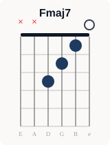
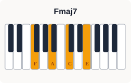
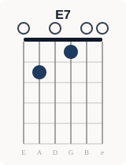
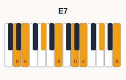
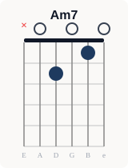
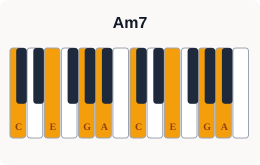
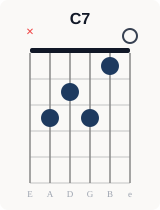
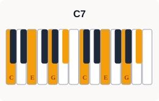

<div style="background:#eceae7;border-radius:8px;padding:1.4rem 1.6rem;margin:1.5rem 0;border-left:4px solid #1e3a5f;"><h3 style="color:#111827;margin-top:0;font-size:1rem;font-weight:700;">🎵 コード進行図（Cキー）</h3><span style="display:block;color:#374151;font-size:.9rem;margin:.4rem 0 1.2rem;"><strong>Fmaj7</strong> → <strong>E7</strong> → <strong>Am7</strong> → <strong>C7</strong>（Ⅳmaj7-Ⅲ7-Ⅵm7-Ⅰ7）</span><div style="display:grid;grid-template-columns:repeat(4,1fr);gap:1rem;overflow-x:auto;"><div style="text-align:center;min-width:0;"><span style="display:block;font-size:.85rem;font-weight:700;color:#111827;margin:0 0 6px;">Fmaj7</span><span style="display:block;font-size:.7rem;color:#6b7280;margin:0 0 4px;">ギター</span><span style="display:block;font-size:.7rem;color:#6b7280;margin:0 0 4px;">ピアノ</span></div><div style="text-align:center;min-width:0;"><span style="display:block;font-size:.85rem;font-weight:700;color:#111827;margin:0 0 6px;">E7</span><span style="display:block;font-size:.7rem;color:#6b7280;margin:0 0 4px;">ギター</span><span style="display:block;font-size:.7rem;color:#6b7280;margin:0 0 4px;">ピアノ</span></div><div style="text-align:center;min-width:0;"><span style="display:block;font-size:.85rem;font-weight:700;color:#111827;margin:0 0 6px;">Am7</span><span style="display:block;font-size:.7rem;color:#6b7280;margin:0 0 4px;">ギター</span><span style="display:block;font-size:.7rem;color:#6b7280;margin:0 0 4px;">ピアノ</span></div><div style="text-align:center;min-width:0;"><span style="display:block;font-size:.85rem;font-weight:700;color:#111827;margin:0 0 6px;">C7</span><span style="display:block;font-size:.7rem;color:#6b7280;margin:0 0 4px;">ギター</span><span style="display:block;font-size:.7rem;color:#6b7280;margin:0 0 4px;">ピアノ</span></div></div><span style="display:block;color:#6b7280;font-size:.75rem;margin:.8rem 0 0;">※ Cキー表示。実際の楽曲は移調される場合があります。「Just the Two of Us」の形では Am7 と C7 の間に Gm7 が入ります（Fmaj7 → E7 → Am7 → Gm7 → C7）。</span><span style="display:block;font-size:.85rem;font-weight:700;color:#374151;margin:1.2rem 0 .5rem;">🎵 演奏する楽器を探してみよう</span><div style="display:flex;flex-wrap:wrap;gap:.5rem;align-items:center;"><span style="font-size:.8rem;font-weight:700;color:#374151;white-space:nowrap;">🎸 ギター</span><a href="https://h.accesstrade.net/sp/cc?rk=01001xqc00os63&url=https%3A%2F%2Fwww.soundhouse.co.jp%2Fsearch%2Findex%2F%3Fsearch_all%3D%25E3%2582%25A2%25E3%2582%25B3%25E3%2583%25BC%25E3%2582%25B9%25E3%2583%2586%25E3%2582%25A3%25E3%2583%2583%25E3%2582%25AF%25E3%2582%25AE%25E3%2582%25BF%25E3%2583%25BC" target="_blank" rel="nofollow noopener" style="display:inline-block;text-decoration:none;" title="フォークギターをサウンドハウスで探す"></a><a href="https://hb.afl.rakuten.co.jp/hgc/58997230.53a20055.58997231.9fa569e6/?pc=https%3A%2F%2Fsearch.rakuten.co.jp%2Fsearch%2Fmall%2F%25E3%2583%2595%25E3%2582%25A9%25E3%2583%25BC%25E3%2582%25AF%25E3%2582%25AE%25E3%2582%25BF%25E3%2583%25BC%2B%25E5%2588%259D%25E5%25BF%2583%25E8%2580%2585%2F&m=https%3A%2F%2Fsearch.rakuten.co.jp%2Fsearch%2Fmall%2F%25E3%2583%2595%25E3%2582%25A9%25E3%2583%25BC%25E3%2582%25AF%25E3%2582%25AE%25E3%2582%25BF%25E3%2583%25BC%2B%25E5%2588%259D%25E5%25BF%2583%25E8%2580%2585%2F" target="_blank" rel="nofollow noopener" style="display:inline-block;text-decoration:none;" title="フォークギターを楽天市場で探す"></a><span style="display:inline-block;width:1px;height:24px;background:#d1d5db;margin:0 .4rem;vertical-align:middle;"></span><span style="font-size:.8rem;font-weight:700;color:#374151;white-space:nowrap;">🎹 キーボード</span><a href="https://h.accesstrade.net/sp/cc?rk=01001xqc00os63&url=https%3A%2F%2Fwww.soundhouse.co.jp%2Fsearch%2Findex%2F%3Fsearch_all%3D%25E3%2582%25AD%25E3%2583%25BC%25E3%2583%259C%25E3%2583%25BC%25E3%2583%2589" target="_blank" rel="nofollow noopener" style="display:inline-block;text-decoration:none;" title="ポータブルキーボードをサウンドハウスで探す"></a><a href="https://hb.afl.rakuten.co.jp/hgc/58997230.53a20055.58997231.9fa569e6/?pc=https%3A%2F%2Fsearch.rakuten.co.jp%2Fsearch%2Fmall%2F%25E3%2583%259D%25E3%2583%25BC%25E3%2582%25BF%25E3%2583%2596%25E3%2583%25AB%25E3%2582%25AD%25E3%2583%25BC%25E3%2583%259C%25E3%2583%25BC%25E3%2583%2589%2F&m=https%3A%2F%2Fsearch.rakuten.co.jp%2Fsearch%2Fmall%2F%25E3%2583%259D%25E3%2583%25BC%25E3%2582%25BF%25E3%2583%2596%25E3%2583%25AB%25E3%2582%25AD%25E3%2583%25BC%25E3%2583%259C%25E3%2583%25BC%25E3%2583%2589%2F" target="_blank" rel="nofollow noopener" style="display:inline-block;text-decoration:none;" title="ポータブルキーボードを楽天市場で探す"></a></div></div>


## 丸サ進行とは？

Cキーで：**Fmaj7 → E7 → Am7 → C7（Ⅳmaj7-Ⅲ7-Ⅵm7-Ⅰ7）**

椎名林檎「丸ノ内サディスティック」（1999年）が、ほぼこの進行だけで1曲を通していることから、曲名を略して「丸サ進行」と呼ばれる。もとになったのはGrover Washington Jr.の「Just the Two of Us」（1981年）で、こちらはAm7とC7の間にGm7をはさんだ **Fmaj7 → E7 → Am7 → Gm7 → C7（Ⅳmaj7-Ⅲ7-Ⅵm7-Ⅴm7-Ⅰ7）**。そのため「Just the Two of Us進行」とも呼ばれ、日本ではどちらの形も「丸サ進行」と呼ぶことが多い。

E7はAm7へ向かうドミナント（Ⅲ7→Ⅵm7）で、一瞬マイナーキーに入ったような切なさが出る。最後のC7（Gm7→C7）は最初のFmaj7に戻るためのドミナントなので、4小節をくり返しても終わった感じがせず、ループさせやすい。

<div style="background:#eceae7;border-radius:8px;padding:1.2rem 1.4rem;margin:1.5rem 0;border-left:4px solid #1e3a5f;"><h3 style="color:#111827;margin-top:0;font-size:1rem;font-weight:700;">🌍 世界での使われ方</h3><ul style="color:#111827;"><li><strong>欧米</strong>：Grover Washington Jr.「Just the Two of Us」（1981年、歌: Bill Withers）が代表例。英語圏でもこの曲名の進行として知られる</li><li><strong>日本</strong>：MISIA「つつみ込むように…」（1998年）や椎名林檎「丸ノ内サディスティック」（1999年）のあと、2010年代後半からボーカロイド曲（メーベル・フィクサー・KING）やJ-POP（愛を伝えたいだとか・夜に駆ける・Pretender）で一気に増えた。下の20曲のうち14曲が2016年以降の曲</li></ul></div>

---

## 丸サ進行を使った代表曲20選


<div class="song-grid" style="display:grid;grid-template-columns:repeat(2,minmax(0,1fr));gap:.6rem;margin:1rem 0;"><div style="background:#f0eeeb;border-radius:6px;padding:1rem 1.2rem;margin:0;border-left:3px solid #1e3a5f;"><div style="display:flex;align-items:baseline;gap:.6rem;margin-bottom:.5rem;">  <span style="color:#64748b;font-size:.8rem;min-width:1.8rem;">#01</span>  <span style="color:#111827;font-weight:bold;">「Just the Two of Us」</span>  <span style="color:#64748b;font-size:.85rem;">（1981年）</span>  <span style="color:#4b5563;">— Grover Washington Jr. feat. Bill Withers</span></div><span style="display:block;color:#6b7280;font-size:.82rem;margin:.2rem 0 .7rem 2.4rem;">収録: シングル（アルバム「Winelight」収録）。「I see the crystal raindrops」などで使用（ⅣM7→Ⅲ7→Ⅵm7→Ⅴm7→Ⅰ7）</span><div class="song-links"><a class="song-btn-img" href="https://ck.jp.ap.valuecommerce.com/servlet/referral?sid=3771735&pid=892732031&vc_url=https%3A%2F%2Frecochoku.jp%2Fsearch%2Fall%3Fq%3DJust%2520the%2520Two%2520of%2520Us%2520Grover%2520Washington" target="_blank" rel="nofollow sponsored noopener"></a><a class="song-btn-img" href="https://www.print-gakufu.com/search/result/score___keyword__Just%20the%20Two%20of%20Us/" target="_blank" rel="nofollow sponsored noopener"></a></div></div><div style="background:#f0eeeb;border-radius:6px;padding:1rem 1.2rem;margin:0;border-left:3px solid #1e3a5f;"><div style="display:flex;align-items:baseline;gap:.6rem;margin-bottom:.5rem;">  <span style="color:#64748b;font-size:.8rem;min-width:1.8rem;">#02</span>  <span style="color:#111827;font-weight:bold;">「つつみ込むように…」</span>  <span style="color:#64748b;font-size:.85rem;">（1998年）</span>  <span style="color:#4b5563;">— MISIA</span></div><span style="display:block;color:#6b7280;font-size:.82rem;margin:.2rem 0 .7rem 2.4rem;">収録: デビューシングル。「恋人と呼びあえる時間の中で」などで使用（ⅣM7→Ⅲ7→Ⅵm7→Ⅴm7→Ⅰ7）。レコチョクは本人の15周年リアレンジ版</span><div class="song-links"><a class="song-btn-img" href="https://ck.jp.ap.valuecommerce.com/servlet/referral?sid=3771735&pid=892732031&vc_url=https%3A%2F%2Frecochoku.jp%2Fsearch%2Fall%3Fq%3D%25E3%2581%25A4%25E3%2581%25A4%25E3%2581%25BF%25E8%25BE%25BC%25E3%2582%2580%25E3%2582%2588%25E3%2581%2586%25E3%2581%25AB%2520MISIA" target="_blank" rel="nofollow sponsored noopener"></a><a class="song-btn-img" href="https://www.print-gakufu.com/search/result/score___keyword__%E3%81%A4%E3%81%A4%E3%81%BF%E8%BE%BC%E3%82%80%E3%82%88%E3%81%86%E3%81%AB%E2%80%A6/" target="_blank" rel="nofollow sponsored noopener"></a></div></div><div style="background:#f0eeeb;border-radius:6px;padding:1rem 1.2rem;margin:0;border-left:3px solid #1e3a5f;"><div style="display:flex;align-items:baseline;gap:.6rem;margin-bottom:.5rem;">  <span style="color:#64748b;font-size:.8rem;min-width:1.8rem;">#03</span>  <span style="color:#111827;font-weight:bold;">「丸ノ内サディスティック」</span>  <span style="color:#64748b;font-size:.85rem;">（1999年）</span>  <span style="color:#4b5563;">— 椎名林檎</span></div><span style="display:block;color:#6b7280;font-size:.82rem;margin:.2rem 0 .7rem 2.4rem;">収録: アルバム「無罪モラトリアム」。進行の名前の由来。「報酬は入社後並行線で」など曲全体で使用（ⅣM7→Ⅲ7→Ⅵm7→Ⅰ7）</span><div class="song-links"><a class="song-btn-img" href="https://ck.jp.ap.valuecommerce.com/servlet/referral?sid=3771735&pid=892732031&vc_url=https%3A%2F%2Frecochoku.jp%2Fsearch%2Fall%3Fq%3D%25E4%25B8%25B8%25E3%2583%258E%25E5%2586%2585%25E3%2582%25B5%25E3%2583%2587%25E3%2582%25A3%25E3%2582%25B9%25E3%2583%2586%25E3%2582%25A3%25E3%2583%2583%25E3%2582%25AF%2520%25E6%25A4%258E%25E5%2590%258D%25E6%259E%2597%25E6%25AA%258E" target="_blank" rel="nofollow sponsored noopener"></a><a class="song-btn-img" href="https://www.print-gakufu.com/search/result/score___keyword__%E4%B8%B8%E3%83%8E%E5%86%85%E3%82%B5%E3%83%87%E3%82%A3%E3%82%B9%E3%83%86%E3%82%A3%E3%83%83%E3%82%AF/" target="_blank" rel="nofollow sponsored noopener"></a></div></div><div style="background:#f0eeeb;border-radius:6px;padding:1rem 1.2rem;margin:0;border-left:3px solid #1e3a5f;"><div style="display:flex;align-items:baseline;gap:.6rem;margin-bottom:.5rem;">  <span style="color:#64748b;font-size:.8rem;min-width:1.8rem;">#04</span>  <span style="color:#111827;font-weight:bold;">「A Perfect Sky」</span>  <span style="color:#64748b;font-size:.85rem;">（2006年）</span>  <span style="color:#4b5563;">— BONNIE PINK</span></div><span style="display:block;color:#6b7280;font-size:.82rem;margin:.2rem 0 .7rem 2.4rem;">収録: シングル／資生堂「ANESSA」CMソング。「I'm looking for a perfect sky」などで使用</span><div class="song-links"><a class="song-btn-img" href="https://ck.jp.ap.valuecommerce.com/servlet/referral?sid=3771735&pid=892732031&vc_url=https%3A%2F%2Frecochoku.jp%2Fsearch%2Fall%3Fq%3DA%2520Perfect%2520Sky%2520BONNIE%2520PINK" target="_blank" rel="nofollow sponsored noopener"></a><a class="song-btn-img" href="https://www.print-gakufu.com/search/result/score___keyword__A%20Perfect%20Sky/" target="_blank" rel="nofollow sponsored noopener"></a></div></div><div style="background:#f0eeeb;border-radius:6px;padding:1rem 1.2rem;margin:0;border-left:3px solid #1e3a5f;"><div style="display:flex;align-items:baseline;gap:.6rem;margin-bottom:.5rem;">  <span style="color:#64748b;font-size:.8rem;min-width:1.8rem;">#05</span>  <span style="color:#111827;font-weight:bold;">「恋愛裁判」</span>  <span style="color:#64748b;font-size:.85rem;">（2014年）</span>  <span style="color:#4b5563;">— 40mP</span></div><span style="display:block;color:#6b7280;font-size:.82rem;margin:.2rem 0 .7rem 2.4rem;">収録: ボーカロイド曲（歌: 初音ミク）。「そう、僕は君だけが全てさ」などで使用</span><div class="song-links"><a class="song-btn-img" href="https://ck.jp.ap.valuecommerce.com/servlet/referral?sid=3771735&pid=892732031&vc_url=https%3A%2F%2Frecochoku.jp%2Fsearch%2Fall%3Fq%3D%25E6%2581%258B%25E6%2584%259B%25E8%25A3%2581%25E5%2588%25A4%252040mP" target="_blank" rel="nofollow sponsored noopener"></a><a class="song-btn-img" href="https://www.print-gakufu.com/search/result/score___keyword__%E6%81%8B%E6%84%9B%E8%A3%81%E5%88%A4/" target="_blank" rel="nofollow sponsored noopener"></a></div></div><div style="background:#f0eeeb;border-radius:6px;padding:1rem 1.2rem;margin:0;border-left:3px solid #1e3a5f;"><div style="display:flex;align-items:baseline;gap:.6rem;margin-bottom:.5rem;">  <span style="color:#64748b;font-size:.8rem;min-width:1.8rem;">#06</span>  <span style="color:#111827;font-weight:bold;">「長く短い祭」</span>  <span style="color:#64748b;font-size:.85rem;">（2015年）</span>  <span style="color:#4b5563;">— 椎名林檎</span></div><span style="display:block;color:#6b7280;font-size:.82rem;margin:.2rem 0 .7rem 2.4rem;">収録: シングル／「コカ・コーラ」CMソング。「天上天下繋ぐ花火哉」などで使用（ⅣM7→Ⅲ7→Ⅵm7→Ⅰ7）</span><div class="song-links"><a class="song-btn-img" href="https://ck.jp.ap.valuecommerce.com/servlet/referral?sid=3771735&pid=892732031&vc_url=https%3A%2F%2Frecochoku.jp%2Fsearch%2Fall%3Fq%3D%25E9%2595%25B7%25E3%2581%258F%25E7%259F%25AD%25E3%2581%2584%25E7%25A5%25AD%2520%25E6%25A4%258E%25E5%2590%258D%25E6%259E%2597%25E6%25AA%258E" target="_blank" rel="nofollow sponsored noopener"></a><a class="song-btn-img" href="https://www.print-gakufu.com/search/result/score___keyword__%E9%95%B7%E3%81%8F%E7%9F%AD%E3%81%84%E7%A5%AD/" target="_blank" rel="nofollow sponsored noopener"></a></div></div><div style="background:#f0eeeb;border-radius:6px;padding:1rem 1.2rem;margin:0;border-left:3px solid #1e3a5f;"><div style="display:flex;align-items:baseline;gap:.6rem;margin-bottom:.5rem;">  <span style="color:#64748b;font-size:.8rem;min-width:1.8rem;">#07</span>  <span style="color:#111827;font-weight:bold;">「メーベル」</span>  <span style="color:#64748b;font-size:.85rem;">（2016年）</span>  <span style="color:#4b5563;">— バルーン</span></div><span style="display:block;color:#6b7280;font-size:.82rem;margin:.2rem 0 .7rem 2.4rem;">収録: ボーカロイド曲（歌: flower）。「笑えないわ」などで使用（ⅣM7→Ⅲ7→Ⅵm7→Ⅰ7）</span><div class="song-links"><a class="song-btn-img" href="https://ck.jp.ap.valuecommerce.com/servlet/referral?sid=3771735&pid=892732031&vc_url=https%3A%2F%2Frecochoku.jp%2Fsearch%2Fall%3Fq%3D%25E3%2583%2590%25E3%2583%25AB%25E3%2583%25BC%25E3%2583%25B3%2520%25E3%2583%25A1%25E3%2583%25BC%25E3%2583%2599%25E3%2583%25AB" target="_blank" rel="nofollow sponsored noopener"></a><a class="song-btn-img" href="https://www.print-gakufu.com/search/result/score___keyword__%E3%83%A1%E3%83%BC%E3%83%99%E3%83%AB/" target="_blank" rel="nofollow sponsored noopener"></a></div></div><div style="background:#f0eeeb;border-radius:6px;padding:1rem 1.2rem;margin:0;border-left:3px solid #1e3a5f;"><div style="display:flex;align-items:baseline;gap:.6rem;margin-bottom:.5rem;">  <span style="color:#64748b;font-size:.8rem;min-width:1.8rem;">#08</span>  <span style="color:#111827;font-weight:bold;">「愛を伝えたいだとか」</span>  <span style="color:#64748b;font-size:.85rem;">（2017年）</span>  <span style="color:#4b5563;">— あいみょん</span></div><span style="display:block;color:#6b7280;font-size:.82rem;margin:.2rem 0 .7rem 2.4rem;">収録: シングル。「揺れるカーテン」など曲全体で使用（ⅣM7→Ⅲ7→Ⅵm7→Ⅰ）</span><div class="song-links"><a class="song-btn-img" href="https://ck.jp.ap.valuecommerce.com/servlet/referral?sid=3771735&pid=892732031&vc_url=https%3A%2F%2Frecochoku.jp%2Fsearch%2Fall%3Fq%3D%25E6%2584%259B%25E3%2582%2592%25E4%25BC%259D%25E3%2581%2588%25E3%2581%259F%25E3%2581%2584%25E3%2581%25A0%25E3%2581%25A8%25E3%2581%258B%2520%25E3%2581%2582%25E3%2581%2584%25E3%2581%25BF%25E3%2582%2587%25E3%2582%2593" target="_blank" rel="nofollow sponsored noopener"></a><a class="song-btn-img" href="https://www.print-gakufu.com/search/result/score___keyword__%E6%84%9B%E3%82%92%E4%BC%9D%E3%81%88%E3%81%9F%E3%81%84%E3%81%A0%E3%81%A8%E3%81%8B/" target="_blank" rel="nofollow sponsored noopener"></a></div></div><div style="background:#f0eeeb;border-radius:6px;padding:1rem 1.2rem;margin:0;border-left:3px solid #1e3a5f;"><div style="display:flex;align-items:baseline;gap:.6rem;margin-bottom:.5rem;">  <span style="color:#64748b;font-size:.8rem;min-width:1.8rem;">#09</span>  <span style="color:#111827;font-weight:bold;">「フィクサー」</span>  <span style="color:#64748b;font-size:.85rem;">（2017年）</span>  <span style="color:#4b5563;">— ぬゆり</span></div><span style="display:block;color:#6b7280;font-size:.82rem;margin:.2rem 0 .7rem 2.4rem;">収録: ボーカロイド曲（歌: flower）。「あしたから生きていく」など曲全体で使用（Ⅳ→Ⅲ7→Ⅵm7→Ⅰ）</span><div class="song-links"><a class="song-btn-img" href="https://music.youtube.com/search?q=%E3%83%95%E3%82%A3%E3%82%AF%E3%82%B5%E3%83%BC%20%E3%81%AC%E3%82%86%E3%82%8A" target="_blank" rel="nofollow noopener"></a><a class="song-btn-img" href="https://www.print-gakufu.com/search/result/score___keyword__%E3%83%95%E3%82%A3%E3%82%AF%E3%82%B5%E3%83%BC/" target="_blank" rel="nofollow sponsored noopener"></a></div></div><div style="background:#f0eeeb;border-radius:6px;padding:1rem 1.2rem;margin:0;border-left:3px solid #1e3a5f;"><div style="display:flex;align-items:baseline;gap:.6rem;margin-bottom:.5rem;">  <span style="color:#64748b;font-size:.8rem;min-width:1.8rem;">#10</span>  <span style="color:#111827;font-weight:bold;">「脳裏上のクラッカー」</span>  <span style="color:#64748b;font-size:.85rem;">（2018年）</span>  <span style="color:#4b5563;">— ずっと真夜中でいいのに。</span></div><span style="display:block;color:#6b7280;font-size:.82rem;margin:.2rem 0 .7rem 2.4rem;">収録: デジタルシングル。「don't stop 脳裏上に」などで使用（ⅣM7→Ⅲ7→Ⅵm7→Ⅴm7）</span><div class="song-links"><a class="song-btn-img" href="https://ck.jp.ap.valuecommerce.com/servlet/referral?sid=3771735&pid=892732031&vc_url=https%3A%2F%2Frecochoku.jp%2Fsearch%2Fall%3Fq%3D%25E8%2584%25B3%25E8%25A3%258F%25E4%25B8%258A%25E3%2581%25AE%25E3%2582%25AF%25E3%2583%25A9%25E3%2583%2583%25E3%2582%25AB%25E3%2583%25BC%2520%25E3%2581%259A%25E3%2581%25A3%25E3%2581%25A8%25E7%259C%259F%25E5%25A4%259C%25E4%25B8%25AD%25E3%2581%25A7%25E3%2581%2584%25E3%2581%2584%25E3%2581%25AE%25E3%2581%25AB%25E3%2580%2582" target="_blank" rel="nofollow sponsored noopener"></a></div></div><div style="background:#f0eeeb;border-radius:6px;padding:1rem 1.2rem;margin:0;border-left:3px solid #1e3a5f;"><div style="display:flex;align-items:baseline;gap:.6rem;margin-bottom:.5rem;">  <span style="color:#64748b;font-size:.8rem;min-width:1.8rem;">#11</span>  <span style="color:#111827;font-weight:bold;">「Pretender」</span>  <span style="color:#64748b;font-size:.85rem;">（2019年）</span>  <span style="color:#4b5563;">— Official髭男dism</span></div><span style="display:block;color:#6b7280;font-size:.82rem;margin:.2rem 0 .7rem 2.4rem;">収録: シングル／映画「コンフィデンスマンJP ロマンス編」主題歌。サビ「もっと違う設定で」で使用</span><div class="song-links"><a class="song-btn-img" href="https://ck.jp.ap.valuecommerce.com/servlet/referral?sid=3771735&pid=892732031&vc_url=https%3A%2F%2Frecochoku.jp%2Fsearch%2Fall%3Fq%3DPretender%2520Official%25E9%25AB%25AD%25E7%2594%25B7dism" target="_blank" rel="nofollow sponsored noopener"></a><a class="song-btn-img" href="https://www.print-gakufu.com/search/result/score___keyword__Pretender/" target="_blank" rel="nofollow sponsored noopener"></a></div></div><div style="background:#f0eeeb;border-radius:6px;padding:1rem 1.2rem;margin:0;border-left:3px solid #1e3a5f;"><div style="display:flex;align-items:baseline;gap:.6rem;margin-bottom:.5rem;">  <span style="color:#64748b;font-size:.8rem;min-width:1.8rem;">#12</span>  <span style="color:#111827;font-weight:bold;">「夜に駆ける」</span>  <span style="color:#64748b;font-size:.85rem;">（2019年）</span>  <span style="color:#4b5563;">— YOASOBI</span></div><span style="display:block;color:#6b7280;font-size:.82rem;margin:.2rem 0 .7rem 2.4rem;">収録: デジタルシングル。「その一言で全てが分かった」など曲全体で使用</span><div class="song-links"><a class="song-btn-img" href="https://ck.jp.ap.valuecommerce.com/servlet/referral?sid=3771735&pid=892732031&vc_url=https%3A%2F%2Frecochoku.jp%2Fsearch%2Fall%3Fq%3D%25E5%25A4%259C%25E3%2581%25AB%25E9%25A7%2586%25E3%2581%2591%25E3%2582%258B%2520YOASOBI" target="_blank" rel="nofollow sponsored noopener"></a><a class="song-btn-img" href="https://www.print-gakufu.com/search/result/score___keyword__%E5%A4%9C%E3%81%AB%E9%A7%86%E3%81%91%E3%82%8B/" target="_blank" rel="nofollow sponsored noopener"></a></div></div><div style="background:#f0eeeb;border-radius:6px;padding:1rem 1.2rem;margin:0;border-left:3px solid #1e3a5f;"><div style="display:flex;align-items:baseline;gap:.6rem;margin-bottom:.5rem;">  <span style="color:#64748b;font-size:.8rem;min-width:1.8rem;">#13</span>  <span style="color:#111827;font-weight:bold;">「不可幸力」</span>  <span style="color:#64748b;font-size:.85rem;">（2020年）</span>  <span style="color:#4b5563;">— Vaundy</span></div><span style="display:block;color:#6b7280;font-size:.82rem;margin:.2rem 0 .7rem 2.4rem;">収録: デジタルシングル。「愛で揺れる世界の中で僕達は」などで使用</span><div class="song-links"><a class="song-btn-img" href="https://ck.jp.ap.valuecommerce.com/servlet/referral?sid=3771735&pid=892732031&vc_url=https%3A%2F%2Frecochoku.jp%2Fsearch%2Fall%3Fq%3D%25E4%25B8%258D%25E5%258F%25AF%25E5%25B9%25B8%25E5%258A%259B%2520Vaundy" target="_blank" rel="nofollow sponsored noopener"></a><a class="song-btn-img" href="https://www.print-gakufu.com/search/result/score___keyword__%E4%B8%8D%E5%8F%AF%E5%B9%B8%E5%8A%9B/" target="_blank" rel="nofollow sponsored noopener"></a></div></div><div style="background:#f0eeeb;border-radius:6px;padding:1rem 1.2rem;margin:0;border-left:3px solid #1e3a5f;"><div style="display:flex;align-items:baseline;gap:.6rem;margin-bottom:.5rem;">  <span style="color:#64748b;font-size:.8rem;min-width:1.8rem;">#14</span>  <span style="color:#111827;font-weight:bold;">「I LOVE...」</span>  <span style="color:#64748b;font-size:.85rem;">（2020年）</span>  <span style="color:#4b5563;">— Official髭男dism</span></div><span style="display:block;color:#6b7280;font-size:.82rem;margin:.2rem 0 .7rem 2.4rem;">収録: デジタルシングル／ドラマ「恋はつづくよどこまでも」主題歌。Aメロ「僕が見つめる景色の」などで使用</span><div class="song-links"><a class="song-btn-img" href="https://ck.jp.ap.valuecommerce.com/servlet/referral?sid=3771735&pid=892732031&vc_url=https%3A%2F%2Frecochoku.jp%2Fsearch%2Fall%3Fq%3DI%2520LOVE...%2520Official%25E9%25AB%25AD%25E7%2594%25B7dism" target="_blank" rel="nofollow sponsored noopener"></a><a class="song-btn-img" href="https://www.print-gakufu.com/search/result/score___keyword__I%20LOVE.../" target="_blank" rel="nofollow sponsored noopener"></a></div></div><div style="background:#f0eeeb;border-radius:6px;padding:1rem 1.2rem;margin:0;border-left:3px solid #1e3a5f;"><div style="display:flex;align-items:baseline;gap:.6rem;margin-bottom:.5rem;">  <span style="color:#64748b;font-size:.8rem;min-width:1.8rem;">#15</span>  <span style="color:#111827;font-weight:bold;">「春を告げる」</span>  <span style="color:#64748b;font-size:.85rem;">（2020年）</span>  <span style="color:#4b5563;">— yama</span></div><span style="display:block;color:#6b7280;font-size:.82rem;margin:.2rem 0 .7rem 2.4rem;">収録: デジタルシングル（作詞・作曲: くじら）。「深夜東京の6畳半」などで使用</span><div class="song-links"><a class="song-btn-img" href="https://ck.jp.ap.valuecommerce.com/servlet/referral?sid=3771735&pid=892732031&vc_url=https%3A%2F%2Frecochoku.jp%2Fsearch%2Fall%3Fq%3D%25E6%2598%25A5%25E3%2582%2592%25E5%2591%258A%25E3%2581%2592%25E3%2582%258B%2520yama" target="_blank" rel="nofollow sponsored noopener"></a><a class="song-btn-img" href="https://www.print-gakufu.com/search/result/score___keyword__%E6%98%A5%E3%82%92%E5%91%8A%E3%81%92%E3%82%8B/" target="_blank" rel="nofollow sponsored noopener"></a></div></div><div style="background:#f0eeeb;border-radius:6px;padding:1rem 1.2rem;margin:0;border-left:3px solid #1e3a5f;"><div style="display:flex;align-items:baseline;gap:.6rem;margin-bottom:.5rem;">  <span style="color:#64748b;font-size:.8rem;min-width:1.8rem;">#16</span>  <span style="color:#111827;font-weight:bold;">「KING」</span>  <span style="color:#64748b;font-size:.85rem;">（2020年）</span>  <span style="color:#4b5563;">— Kanaria</span></div><span style="display:block;color:#6b7280;font-size:.82rem;margin:.2rem 0 .7rem 2.4rem;">収録: ボーカロイド曲（歌: GUMI）。曲全体で使用（ⅣM7→Ⅲ7→Ⅵm→Ⅰ）</span><div class="song-links"><a class="song-btn-img" href="https://ck.jp.ap.valuecommerce.com/servlet/referral?sid=3771735&pid=892732031&vc_url=https%3A%2F%2Frecochoku.jp%2Fsearch%2Fall%3Fq%3DKING%2520Kanaria" target="_blank" rel="nofollow sponsored noopener"></a><a class="song-btn-img" href="https://www.print-gakufu.com/search/result/score___keyword__KING/" target="_blank" rel="nofollow sponsored noopener"></a></div></div><div style="background:#f0eeeb;border-radius:6px;padding:1rem 1.2rem;margin:0;border-left:3px solid #1e3a5f;"><div style="display:flex;align-items:baseline;gap:.6rem;margin-bottom:.5rem;">  <span style="color:#64748b;font-size:.8rem;min-width:1.8rem;">#17</span>  <span style="color:#111827;font-weight:bold;">「MILABO」</span>  <span style="color:#64748b;font-size:.85rem;">（2020年）</span>  <span style="color:#4b5563;">— ずっと真夜中でいいのに。</span></div><span style="display:block;color:#6b7280;font-size:.82rem;margin:.2rem 0 .7rem 2.4rem;">収録: デジタルシングル／映画「さんかく窓の外側は夜」オープニングテーマ。「バレたくはないから」などで使用</span><div class="song-links"><a class="song-btn-img" href="https://ck.jp.ap.valuecommerce.com/servlet/referral?sid=3771735&pid=892732031&vc_url=https%3A%2F%2Frecochoku.jp%2Fsearch%2Fall%3Fq%3DMILABO%2520%25E3%2581%259A%25E3%2581%25A3%25E3%2581%25A8%25E7%259C%259F%25E5%25A4%259C%25E4%25B8%25AD%25E3%2581%25A7%25E3%2581%2584%25E3%2581%2584%25E3%2581%25AE%25E3%2581%25AB%25E3%2580%2582" target="_blank" rel="nofollow sponsored noopener"></a></div></div><div style="background:#f0eeeb;border-radius:6px;padding:1rem 1.2rem;margin:0;border-left:3px solid #1e3a5f;"><div style="display:flex;align-items:baseline;gap:.6rem;margin-bottom:.5rem;">  <span style="color:#64748b;font-size:.8rem;min-width:1.8rem;">#18</span>  <span style="color:#111827;font-weight:bold;">「エンヴィーベイビー」</span>  <span style="color:#64748b;font-size:.85rem;">（2021年）</span>  <span style="color:#4b5563;">— Kanaria</span></div><span style="display:block;color:#6b7280;font-size:.82rem;margin:.2rem 0 .7rem 2.4rem;">収録: ボーカロイド曲（歌: GUMI）。「タイトロープは崩れる」などで使用（ⅣM7→Ⅲ→Ⅵm→Ⅰ）</span><div class="song-links"><a class="song-btn-img" href="https://ck.jp.ap.valuecommerce.com/servlet/referral?sid=3771735&pid=892732031&vc_url=https%3A%2F%2Frecochoku.jp%2Fsearch%2Fall%3Fq%3D%25E3%2582%25A8%25E3%2583%25B3%25E3%2583%25B4%25E3%2582%25A3%25E3%2583%25BC%25E3%2583%2599%25E3%2582%25A4%25E3%2583%2593%25E3%2583%25BC%2520Kanaria" target="_blank" rel="nofollow sponsored noopener"></a><a class="song-btn-img" href="https://www.print-gakufu.com/search/result/score___keyword__%E3%82%A8%E3%83%B3%E3%83%B4%E3%82%A3%E3%83%BC%E3%83%99%E3%82%A4%E3%83%93%E3%83%BC/" target="_blank" rel="nofollow sponsored noopener"></a></div></div><div style="background:#f0eeeb;border-radius:6px;padding:1rem 1.2rem;margin:0;border-left:3px solid #1e3a5f;"><div style="display:flex;align-items:baseline;gap:.6rem;margin-bottom:.5rem;">  <span style="color:#64748b;font-size:.8rem;min-width:1.8rem;">#19</span>  <span style="color:#111827;font-weight:bold;">「アイドル」</span>  <span style="color:#64748b;font-size:.85rem;">（2023年）</span>  <span style="color:#4b5563;">— YOASOBI</span></div><span style="display:block;color:#6b7280;font-size:.82rem;margin:.2rem 0 .7rem 2.4rem;">収録: シングル／アニメ「【推しの子】」オープニング。「嘘か本当か知り得ない」などで使用</span><div class="song-links"><a class="song-btn-img" href="https://ck.jp.ap.valuecommerce.com/servlet/referral?sid=3771735&pid=892732031&vc_url=https%3A%2F%2Frecochoku.jp%2Fsearch%2Fall%3Fq%3D%25E3%2582%25A2%25E3%2582%25A4%25E3%2583%2589%25E3%2583%25AB%2520YOASOBI" target="_blank" rel="nofollow sponsored noopener"></a><a class="song-btn-img" href="https://www.print-gakufu.com/search/result/score___keyword__%E3%82%A2%E3%82%A4%E3%83%89%E3%83%AB/" target="_blank" rel="nofollow sponsored noopener"></a></div></div><div style="background:#f0eeeb;border-radius:6px;padding:1rem 1.2rem;margin:0;border-left:3px solid #1e3a5f;"><div style="display:flex;align-items:baseline;gap:.6rem;margin-bottom:.5rem;">  <span style="color:#64748b;font-size:.8rem;min-width:1.8rem;">#20</span>  <span style="color:#111827;font-weight:bold;">「青のすみか」</span>  <span style="color:#64748b;font-size:.85rem;">（2023年）</span>  <span style="color:#4b5563;">— キタニタツヤ</span></div><span style="display:block;color:#6b7280;font-size:.82rem;margin:.2rem 0 .7rem 2.4rem;">収録: シングル／アニメ「呪術廻戦」懐玉・玉折 オープニング。「今でも青が棲んでいる」で使用</span><div class="song-links"><a class="song-btn-img" href="https://ck.jp.ap.valuecommerce.com/servlet/referral?sid=3771735&pid=892732031&vc_url=https%3A%2F%2Frecochoku.jp%2Fsearch%2Fall%3Fq%3D%25E9%259D%2592%25E3%2581%25AE%25E3%2581%2599%25E3%2581%25BF%25E3%2581%258B%2520%25E3%2582%25AD%25E3%2582%25BF%25E3%2583%258B%25E3%2582%25BF%25E3%2583%2584%25E3%2583%25A4" target="_blank" rel="nofollow sponsored noopener"></a><a class="song-btn-img" href="https://www.print-gakufu.com/search/result/score___keyword__%E9%9D%92%E3%81%AE%E3%81%99%E3%81%BF%E3%81%8B/" target="_blank" rel="nofollow sponsored noopener"></a></div></div></div>

---

## ピアノでの弾き方

```
Fmaj7: ファ・ラ・ド・ミ
E7   : ミ・ソ#・シ・レ
Am7  : ラ・ド・ミ・ソ
Gm7  : ソ・シ♭・レ・ファ（Just the Two of Usの形）
C7   : ド・ミ・ソ・シ♭
```

E7のソ#は次のAm7のラへ、C7のシ♭は次のFmaj7のラへ、それぞれ半音で動く。この2つの音を意識すると、コードのつながりがなめらかになる。

<div style="display:flex;flex-wrap:wrap;gap:.6rem;align-items:center;margin-top:.8rem;"><span style="font-size:.78rem;font-weight:700;color:#374151;white-space:nowrap;">🎹 キーボードを探す</span><a href="https://h.accesstrade.net/sp/cc?rk=01001xqc00os63&url=https%3A%2F%2Fwww.soundhouse.co.jp%2Fsearch%2Findex%2F%3Fsearch_all%3D%25E3%2582%25AD%25E3%2583%25BC%25E3%2583%259C%25E3%2583%25BC%25E3%2583%2589" target="_blank" rel="nofollow noopener" title="キーボードをサウンドハウスで探す"></a><a href="https://hb.afl.rakuten.co.jp/hgc/58997230.53a20055.58997231.9fa569e6/?pc=https%3A%2F%2Fsearch.rakuten.co.jp%2Fsearch%2Fmall%2F%25E3%2583%259D%25E3%2583%25BC%25E3%2582%25BF%25E3%2583%2596%25E3%2583%25AB%25E3%2582%25AD%25E3%2583%25BC%25E3%2583%259C%25E3%2583%25BC%25E3%2583%2589%2F&m=https%3A%2F%2Fsearch.rakuten.co.jp%2Fsearch%2Fmall%2F%25E3%2583%259D%25E3%2583%25BC%25E3%2582%25BF%25E3%2583%2596%25E3%2583%25AB%25E3%2582%25AD%25E3%2583%25BC%25E3%2583%259C%25E3%2583%25BC%25E3%2583%2589%2F" target="_blank" rel="nofollow noopener" title="キーボードを楽天市場で探す"></a><span style="display:inline-block;width:1px;height:24px;background:#d1d5db;margin:0 .2rem;"></span><span style="font-size:.78rem;font-weight:700;color:#374151;white-space:nowrap;">📖 コード教則本</span><a href="https://hb.afl.rakuten.co.jp/hgc/58997230.53a20055.58997231.9fa569e6/?pc=https%3A%2F%2Fbooks.rakuten.co.jp%2Fsearch%3Fsitem%3D%25E3%2583%2594%25E3%2582%25A2%25E3%2583%258E%2B%25E3%2582%25B3%25E3%2583%25BC%25E3%2583%2589%2B%25E6%2595%2599%25E5%2589%2587%25E6%259C%25AC%26g%3D212&m=https%3A%2F%2Fbooks.rakuten.co.jp%2Fsearch%3Fsitem%3D%25E3%2583%2594%25E3%2582%25A2%25E3%2583%258E%2B%25E3%2582%25B3%25E3%2583%25BC%25E3%2583%2589%2B%25E6%2595%2599%25E5%2589%2587%25E6%259C%25AC%26g%3D212" target="_blank" rel="nofollow noopener" title="ピアノコード教則本を楽天ブックスで探す"></a></div>

---

## ギターでの弾き方

Fmaj7・E7・Am7・C7は、どれも開放弦を使うフォームで弾ける（Just the Two of Usの形で使うGm7だけ3フレットのセーハ）：

```
Fmaj7: 1弦を開放で鳴らすフォーム（xx3210）
E7   : 開放弦フォーム（020100）
Am7  : 開放弦フォーム（x02010）
Gm7  : 3フレットセーハ（353333）
C7   : 開放弦フォーム（x32310）
```

<div style="display:flex;flex-wrap:wrap;gap:.6rem;align-items:center;margin-top:.8rem;"><span style="font-size:.78rem;font-weight:700;color:#374151;white-space:nowrap;">🎸 ギターを探す</span><a href="https://h.accesstrade.net/sp/cc?rk=01001xqc00os63&url=https%3A%2F%2Fwww.soundhouse.co.jp%2Fsearch%2Findex%2F%3Fsearch_all%3D%25E3%2582%25A2%25E3%2582%25B3%25E3%2583%25BC%25E3%2582%25B9%25E3%2583%2586%25E3%2582%25A3%25E3%2583%2583%25E3%2582%25AF%25E3%2582%25AE%25E3%2582%25BF%25E3%2583%25BC" target="_blank" rel="nofollow noopener" title="ギターをサウンドハウスで探す"></a><a href="https://hb.afl.rakuten.co.jp/hgc/58997230.53a20055.58997231.9fa569e6/?pc=https%3A%2F%2Fsearch.rakuten.co.jp%2Fsearch%2Fmall%2F%25E3%2582%25A2%25E3%2582%25B3%25E3%2583%25BC%25E3%2582%25B9%25E3%2583%2586%25E3%2582%25A3%25E3%2583%2583%25E3%2582%25AF%25E3%2582%25AE%25E3%2582%25BF%25E3%2583%25BC%2B%25E5%2588%259D%25E5%25BF%2583%25E8%2580%2585%2B%25E3%2582%25BB%25E3%2583%2583%25E3%2583%2588%2F&m=https%3A%2F%2Fsearch.rakuten.co.jp%2Fsearch%2Fmall%2F%25E3%2582%25A2%25E3%2582%25B3%25E3%2583%25BC%25E3%2582%25B9%25E3%2583%2586%25E3%2582%25A3%25E3%2583%2583%25E3%2582%25AF%25E3%2582%25AE%25E3%2582%25BF%25E3%2583%25BC%2B%25E5%2588%259D%25E5%25BF%2583%25E8%2580%2585%2B%25E3%2582%25BB%25E3%2583%2583%25E3%2583%2588%2F" target="_blank" rel="nofollow noopener" title="アコースティックギターを楽天市場で探す"></a><span style="display:inline-block;width:1px;height:24px;background:#d1d5db;margin:0 .2rem;"></span><span style="font-size:.78rem;font-weight:700;color:#374151;white-space:nowrap;">📖 コード教則本</span><a href="https://hb.afl.rakuten.co.jp/hgc/58997230.53a20055.58997231.9fa569e6/?pc=https%3A%2F%2Fbooks.rakuten.co.jp%2Fsearch%3Fsitem%3D%25E3%2582%25AE%25E3%2582%25BF%25E3%2583%25BC%2B%25E3%2582%25B3%25E3%2583%25BC%25E3%2583%2589%2B%25E6%2595%2599%25E5%2589%2587%25E6%259C%25AC%26g%3D212&m=https%3A%2F%2Fbooks.rakuten.co.jp%2Fsearch%3Fsitem%3D%25E3%2582%25AE%25E3%2582%25BF%25E3%2583%25BC%2B%25E3%2582%25B3%25E3%2583%25BC%25E3%2583%2589%2B%25E6%2595%2599%25E5%2589%2587%25E6%259C%25AC%26g%3D212" target="_blank" rel="nofollow noopener" title="ギターコード教則本を楽天ブックスで探す"></a></div>

---

## 教則本・コードブック

<div style="background:#fff7ed;border:1px solid #fed7aa;border-radius:10px;padding:1rem 1.2rem;">
<p style="font-size:.8rem;font-weight:700;color:#c2410c;margin:0 0 .6rem;">📖 コード進行の教則本を楽天ブックスで購入</p>
<a href="https://hb.afl.rakuten.co.jp/hgc/58997230.53a20055.58997231.9fa569e6/?pc=https%3A%2F%2Fbooks.rakuten.co.jp%2Fsearch%3Fsitem%3D%25E3%2582%25B3%25E3%2583%25BC%25E3%2583%2589%25E9%2580%25B2%25E8%25A1%258C%2B%25E6%2595%2599%25E5%2589%2587%25E6%259C%25AC%26g%3D212&m=https%3A%2F%2Fbooks.rakuten.co.jp%2Fsearch%3Fsitem%3D%25E3%2582%25B3%25E3%2583%25BC%25E3%2583%2589%25E9%2580%25B2%25E8%25A1%258C%2B%25E6%2595%2599%25E5%2589%2587%25E6%259C%25AC%26g%3D212" target="_blank" rel="nofollow noopener" style="display:block;text-decoration:none;text-align:center;"></a>
</div>

---

<div style="display:flex;justify-content:space-between;flex-wrap:wrap;gap:.8rem;margin:2rem 0;"><a href="/chord/chord-progression-03-komuro/" style="display:inline-block;padding:.5rem 1rem;background:rgba(30,58,95,.15);border:1px solid rgba(30,58,95,.25);border-radius:8px;color:#1e3a5f;text-decoration:none;font-size:.9rem;">← #03 小室進行</a><a href="/chord/chord-progression-05-junkan/" style="display:inline-block;padding:.5rem 1rem;background:rgba(30,58,95,.15);border:1px solid rgba(30,58,95,.25);border-radius:8px;color:#1e3a5f;text-decoration:none;font-size:.9rem;">#05 循環コード →</a>
