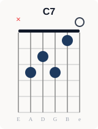
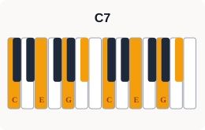
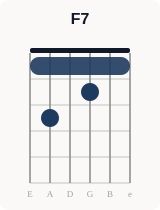
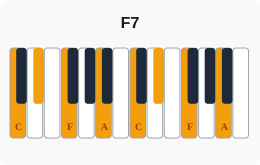
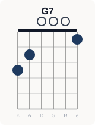
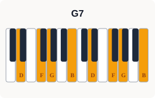

<div style="background:#eceae7;border-radius:8px;padding:1.4rem 1.6rem;margin:1.5rem 0;border-left:4px solid #1e3a5f;"><h3 style="color:#111827;margin-top:0;font-size:1rem;font-weight:700;">🎵 コード進行図（Cキー）</h3><span style="display:block;color:#374151;font-size:.9rem;margin:.4rem 0 1.2rem;"><strong>C7</strong> → <strong>F7</strong> → <strong>G7</strong></span><div style="display:grid;grid-template-columns:repeat(3,1fr);gap:1rem;overflow-x:auto;"><div style="text-align:center;min-width:0;"><span style="display:block;font-size:.85rem;font-weight:700;color:#111827;margin:0 0 6px;">C7</span><span style="display:block;font-size:.7rem;color:#6b7280;margin:0 0 4px;">ギター</span><span style="display:block;font-size:.7rem;color:#6b7280;margin:0 0 4px;">ピアノ</span></div><div style="text-align:center;min-width:0;"><span style="display:block;font-size:.85rem;font-weight:700;color:#111827;margin:0 0 6px;">F7</span><span style="display:block;font-size:.7rem;color:#6b7280;margin:0 0 4px;">ギター</span><span style="display:block;font-size:.7rem;color:#6b7280;margin:0 0 4px;">ピアノ</span></div><div style="text-align:center;min-width:0;"><span style="display:block;font-size:.85rem;font-weight:700;color:#111827;margin:0 0 6px;">G7</span><span style="display:block;font-size:.7rem;color:#6b7280;margin:0 0 4px;">ギター</span><span style="display:block;font-size:.7rem;color:#6b7280;margin:0 0 4px;">ピアノ</span></div></div><span style="display:block;color:#6b7280;font-size:.75rem;margin:.8rem 0 0;">※ Cキー表示。実際の楽曲は移調される場合があります。</span><span style="display:block;font-size:.85rem;font-weight:700;color:#374151;margin:1.2rem 0 .5rem;">🎵 演奏する楽器を探してみよう</span><div style="display:flex;flex-wrap:wrap;gap:.5rem;align-items:center;"><span style="font-size:.8rem;font-weight:700;color:#374151;white-space:nowrap;">🎸 ギター</span><a href="https://h.accesstrade.net/sp/cc?rk=01001xqc00os63&url=https%3A%2F%2Fwww.soundhouse.co.jp%2Fsearch%2Findex%2F%3Fsearch_all%3D%25E3%2582%25A2%25E3%2582%25B3%25E3%2583%25BC%25E3%2582%25B9%25E3%2583%2586%25E3%2582%25A3%25E3%2583%2583%25E3%2582%25AF%25E3%2582%25AE%25E3%2582%25BF%25E3%2583%25BC" target="_blank" rel="nofollow noopener" style="display:inline-block;text-decoration:none;" title="フォークギターをサウンドハウスで探す"></a><a href="https://hb.afl.rakuten.co.jp/hgc/58997230.53a20055.58997231.9fa569e6/?pc=https%3A%2F%2Fsearch.rakuten.co.jp%2Fsearch%2Fmall%2F%25E3%2583%2595%25E3%2582%25A9%25E3%2583%25BC%25E3%2582%25AF%25E3%2582%25AE%25E3%2582%25BF%25E3%2583%25BC%2B%25E5%2588%259D%25E5%25BF%2583%25E8%2580%2585%2F&m=https%3A%2F%2Fsearch.rakuten.co.jp%2Fsearch%2Fmall%2F%25E3%2583%2595%25E3%2582%25A9%25E3%2583%25BC%25E3%2582%25AF%25E3%2582%25AE%25E3%2582%25BF%25E3%2583%25BC%2B%25E5%2588%259D%25E5%25BF%2583%25E8%2580%2585%2F" target="_blank" rel="nofollow noopener" style="display:inline-block;text-decoration:none;" title="フォークギターを楽天市場で探す"></a><span style="display:inline-block;width:1px;height:24px;background:#d1d5db;margin:0 .4rem;vertical-align:middle;"></span><span style="font-size:.8rem;font-weight:700;color:#374151;white-space:nowrap;">🎹 キーボード</span><a href="https://h.accesstrade.net/sp/cc?rk=01001xqc00os63&url=https%3A%2F%2Fwww.soundhouse.co.jp%2Fsearch%2Findex%2F%3Fsearch_all%3D%25E3%2582%25AD%25E3%2583%25BC%25E3%2583%259C%25E3%2583%25BC%25E3%2583%2589" target="_blank" rel="nofollow noopener" style="display:inline-block;text-decoration:none;" title="ポータブルキーボードをサウンドハウスで探す"></a><a href="https://hb.afl.rakuten.co.jp/hgc/58997230.53a20055.58997231.9fa569e6/?pc=https%3A%2F%2Fsearch.rakuten.co.jp%2Fsearch%2Fmall%2F%25E3%2583%259D%25E3%2583%25BC%25E3%2582%25BF%25E3%2583%2596%25E3%2583%25AB%25E3%2582%25AD%25E3%2583%25BC%25E3%2583%259C%25E3%2583%25BC%25E3%2583%2589%2F&m=https%3A%2F%2Fsearch.rakuten.co.jp%2Fsearch%2Fmall%2F%25E3%2583%259D%25E3%2583%25BC%25E3%2582%25BF%25E3%2583%2596%25E3%2583%25AB%25E3%2582%25AD%25E3%2583%25BC%25E3%2583%259C%25E3%2583%25BC%25E3%2583%2589%2F" target="_blank" rel="nofollow noopener" style="display:inline-block;text-decoration:none;" title="ポータブルキーボードを楽天市場で探す"></a></div></div>


## ブルース進行とは？12小節で回す3つのコード

**Ⅰ7 → Ⅳ7 → Ⅴ7**（Cキーなら C7・F7・G7、Eキーなら E7・A7・B7）の3つのコードを、12小節の決まった順番で回すのが「12小節ブルース」。アメリカのブルースで定着した形で、1950年代のロックンロールやR&Bにそのまま受け継がれ、ビートルズやレッド・ツェッペリンの曲にも使われている。

<div style="background:#eceae7;border-radius:8px;padding:1.2rem 1.4rem;margin:1.5rem 0;border-left:4px solid #1e3a5f;"><h3 style="color:#111827;margin-top:0;font-size:1rem;font-weight:700;">🌍 世界での使われ方</h3><ul style="color:#111827;"><li><strong>欧米</strong>：ブルースの基本形。Robert Johnson・B.B. Kingなどのブルースから、Chuck Berry・Elvis Presleyのロックンロール、The Beatles・Led Zeppelinまで幅広く使われている</li><li><strong>日本</strong>：12小節の形をそのまま使ったヒット曲は多くない。憂歌団のようにブルースを中心に演奏するバンドの曲で聴ける</li></ul></div>

---

## ブルース進行を使った代表曲20選

※ カッコ内の度数（Ⅰ7・Ⅳ7など）は、その曲の長調のキーを基準にしています。短調の曲（The Thrill Is Gone）は、平行調の長調から見た度数（主和音＝Ⅵm）で書いています。


<div class="song-grid" style="display:grid;grid-template-columns:repeat(2,minmax(0,1fr));gap:.6rem;margin:1rem 0;"><div style="background:#f0eeeb;border-radius:6px;padding:1rem 1.2rem;margin:0;border-left:3px solid #1e3a5f;"><div style="display:flex;align-items:baseline;gap:.6rem;margin-bottom:.5rem;">  <span style="color:#64748b;font-size:.8rem;min-width:1.8rem;">#01</span>  <span style="color:#111827;font-weight:bold;">「Sweet Home Chicago」</span>  <span style="color:#64748b;font-size:.85rem;">（1937年）</span>  <span style="color:#4b5563;">— Robert Johnson</span></div><span style="display:block;color:#6b7280;font-size:.82rem;margin:.2rem 0 .7rem 2.4rem;">収録: シングル（SP盤・1936年録音）。曲全体が12小節ブルース（Ⅰ7・Ⅳ7・Ⅴ7）の繰り返し</span><div class="song-links"><a class="song-btn-img" href="https://ck.jp.ap.valuecommerce.com/servlet/referral?sid=3771735&pid=892732031&vc_url=https%3A%2F%2Frecochoku.jp%2Fsearch%2Fall%3Fq%3DSweet%2520Home%2520Chicago%2520Robert%2520Johnson" target="_blank" rel="nofollow sponsored noopener"></a><a class="song-btn-img" href="https://www.print-gakufu.com/search/result/score___keyword__Sweet%20Home%20Chicago/" target="_blank" rel="nofollow sponsored noopener"></a></div></div><div style="background:#f0eeeb;border-radius:6px;padding:1rem 1.2rem;margin:0;border-left:3px solid #1e3a5f;"><div style="display:flex;align-items:baseline;gap:.6rem;margin-bottom:.5rem;">  <span style="color:#64748b;font-size:.8rem;min-width:1.8rem;">#02</span>  <span style="color:#111827;font-weight:bold;">「Call It Stormy Monday」</span>  <span style="color:#64748b;font-size:.85rem;">（1947年）</span>  <span style="color:#4b5563;">— T-Bone Walker</span></div><span style="display:block;color:#6b7280;font-size:.82rem;margin:.2rem 0 .7rem 2.4rem;">収録: シングル。Ⅰ7・Ⅳ7・Ⅴ7を中心に、Ⅱ7→Ⅴ7などの経過和音を加えた12小節のスロー・ブルース</span><div class="song-links"><a class="song-btn-img" href="https://ck.jp.ap.valuecommerce.com/servlet/referral?sid=3771735&pid=892732031&vc_url=https%3A%2F%2Frecochoku.jp%2Fsearch%2Fall%3Fq%3DStormy%2520Monday%2520T-Bone%2520Walker" target="_blank" rel="nofollow sponsored noopener"></a><a class="song-btn-img" href="https://www.print-gakufu.com/search/result/score___keyword__Stormy%20Monday/" target="_blank" rel="nofollow sponsored noopener"></a></div></div><div style="background:#f0eeeb;border-radius:6px;padding:1rem 1.2rem;margin:0;border-left:3px solid #1e3a5f;"><div style="display:flex;align-items:baseline;gap:.6rem;margin-bottom:.5rem;">  <span style="color:#64748b;font-size:.8rem;min-width:1.8rem;">#03</span>  <span style="color:#111827;font-weight:bold;">「Shake, Rattle and Roll」</span>  <span style="color:#64748b;font-size:.85rem;">（1954年）</span>  <span style="color:#4b5563;">— Big Joe Turner</span></div><span style="display:block;color:#6b7280;font-size:.82rem;margin:.2rem 0 .7rem 2.4rem;">収録: シングル。曲全体が12小節ブルース（Ⅰ・Ⅳ・Ⅴ）。同じ年にBill Haley &amp; His Cometsもカバー</span><div class="song-links"><a class="song-btn-img" href="https://ck.jp.ap.valuecommerce.com/servlet/referral?sid=3771735&pid=892732031&vc_url=https%3A%2F%2Frecochoku.jp%2Fsearch%2Fall%3Fq%3DShake%2520Rattle%2520And%2520Roll%2520Big%2520Joe%2520Turner" target="_blank" rel="nofollow sponsored noopener"></a></div></div><div style="background:#f0eeeb;border-radius:6px;padding:1rem 1.2rem;margin:0;border-left:3px solid #1e3a5f;"><div style="display:flex;align-items:baseline;gap:.6rem;margin-bottom:.5rem;">  <span style="color:#64748b;font-size:.8rem;min-width:1.8rem;">#04</span>  <span style="color:#111827;font-weight:bold;">「Rock Around the Clock」</span>  <span style="color:#64748b;font-size:.85rem;">（1954年）</span>  <span style="color:#4b5563;">— Bill Haley &amp; His Comets</span></div><span style="display:block;color:#6b7280;font-size:.82rem;margin:.2rem 0 .7rem 2.4rem;">収録: シングル。「We're gonna rock around the clock tonight」など歌の部分が12小節ブルース（Ⅰ・Ⅳ・Ⅴ）</span><div class="song-links"><a class="song-btn-img" href="https://ck.jp.ap.valuecommerce.com/servlet/referral?sid=3771735&pid=892732031&vc_url=https%3A%2F%2Frecochoku.jp%2Fsearch%2Fall%3Fq%3DRock%2520Around%2520The%2520Clock%2520Bill%2520Haley" target="_blank" rel="nofollow sponsored noopener"></a><a class="song-btn-img" href="https://www.print-gakufu.com/search/result/score___keyword__Rock%20Around%20the%20Clock/" target="_blank" rel="nofollow sponsored noopener"></a></div></div><div style="background:#f0eeeb;border-radius:6px;padding:1rem 1.2rem;margin:0;border-left:3px solid #1e3a5f;"><div style="display:flex;align-items:baseline;gap:.6rem;margin-bottom:.5rem;">  <span style="color:#64748b;font-size:.8rem;min-width:1.8rem;">#05</span>  <span style="color:#111827;font-weight:bold;">「Tutti Frutti」</span>  <span style="color:#64748b;font-size:.85rem;">（1955年）</span>  <span style="color:#4b5563;">— Little Richard</span></div><span style="display:block;color:#6b7280;font-size:.82rem;margin:.2rem 0 .7rem 2.4rem;">収録: シングル（アルバム「Here's Little Richard」）。「She knows just what to do」など曲全体が12小節ブルース（Ⅰ・Ⅳ・Ⅴ）</span><div class="song-links"><a class="song-btn-img" href="https://ck.jp.ap.valuecommerce.com/servlet/referral?sid=3771735&pid=892732031&vc_url=https%3A%2F%2Frecochoku.jp%2Fsearch%2Fall%3Fq%3DTutti%2520Frutti%2520Little%2520Richard" target="_blank" rel="nofollow sponsored noopener"></a><a class="song-btn-img" href="https://www.print-gakufu.com/search/result/score___keyword__Tutti%20Frutti/" target="_blank" rel="nofollow sponsored noopener"></a></div></div><div style="background:#f0eeeb;border-radius:6px;padding:1rem 1.2rem;margin:0;border-left:3px solid #1e3a5f;"><div style="display:flex;align-items:baseline;gap:.6rem;margin-bottom:.5rem;">  <span style="color:#64748b;font-size:.8rem;min-width:1.8rem;">#06</span>  <span style="color:#111827;font-weight:bold;">「Every Day I Have the Blues」</span>  <span style="color:#64748b;font-size:.85rem;">（1955年）</span>  <span style="color:#4b5563;">— B.B. King</span></div><span style="display:block;color:#6b7280;font-size:.82rem;margin:.2rem 0 .7rem 2.4rem;">収録: シングル。曲全体が12小節ブルース（Ⅰ7・Ⅳ7・Ⅴ7）。原曲は1935年のPinetop Sparks</span><div class="song-links"><a class="song-btn-img" href="https://ck.jp.ap.valuecommerce.com/servlet/referral?sid=3771735&pid=892732031&vc_url=https%3A%2F%2Frecochoku.jp%2Fsearch%2Fall%3Fq%3DEvery%2520Day%2520I%2520Have%2520The%2520Blues%2520B.B.%2520King" target="_blank" rel="nofollow sponsored noopener"></a><a class="song-btn-img" href="https://www.print-gakufu.com/search/result/score___keyword__Every%20Day%20I%20Have%20the%20Blues/" target="_blank" rel="nofollow sponsored noopener"></a></div></div><div style="background:#f0eeeb;border-radius:6px;padding:1rem 1.2rem;margin:0;border-left:3px solid #1e3a5f;"><div style="display:flex;align-items:baseline;gap:.6rem;margin-bottom:.5rem;">  <span style="color:#64748b;font-size:.8rem;min-width:1.8rem;">#07</span>  <span style="color:#111827;font-weight:bold;">「Blue Suede Shoes」</span>  <span style="color:#64748b;font-size:.85rem;">（1956年）</span>  <span style="color:#4b5563;">— Carl Perkins</span></div><span style="display:block;color:#6b7280;font-size:.82rem;margin:.2rem 0 .7rem 2.4rem;">収録: シングル。曲全体が12小節ブルース（Ⅰ7・Ⅳ7・Ⅴ7）</span><div class="song-links"><a class="song-btn-img" href="https://ck.jp.ap.valuecommerce.com/servlet/referral?sid=3771735&pid=892732031&vc_url=https%3A%2F%2Frecochoku.jp%2Fsearch%2Fall%3Fq%3DBlue%2520Suede%2520Shoes%2520Carl%2520Perkins" target="_blank" rel="nofollow sponsored noopener"></a><a class="song-btn-img" href="https://www.print-gakufu.com/search/result/score___keyword__Blue%20Suede%20Shoes/" target="_blank" rel="nofollow sponsored noopener"></a></div></div><div style="background:#f0eeeb;border-radius:6px;padding:1rem 1.2rem;margin:0;border-left:3px solid #1e3a5f;"><div style="display:flex;align-items:baseline;gap:.6rem;margin-bottom:.5rem;">  <span style="color:#64748b;font-size:.8rem;min-width:1.8rem;">#08</span>  <span style="color:#111827;font-weight:bold;">「Hound Dog」</span>  <span style="color:#64748b;font-size:.85rem;">（1956年）</span>  <span style="color:#4b5563;">— Elvis Presley</span></div><span style="display:block;color:#6b7280;font-size:.82rem;margin:.2rem 0 .7rem 2.4rem;">収録: シングル（「Don't Be Cruel」のカップリング）。曲全体が12小節ブルース（Ⅰ・Ⅳ・Ⅴ）。原曲はBig Mama Thornton（1953年）</span><div class="song-links"><a class="song-btn-img" href="https://ck.jp.ap.valuecommerce.com/servlet/referral?sid=3771735&pid=892732031&vc_url=https%3A%2F%2Frecochoku.jp%2Fsearch%2Fall%3Fq%3DHound%2520Dog%2520Elvis%2520Presley" target="_blank" rel="nofollow sponsored noopener"></a><a class="song-btn-img" href="https://www.print-gakufu.com/search/result/score___keyword__Hound%20Dog/" target="_blank" rel="nofollow sponsored noopener"></a></div></div><div style="background:#f0eeeb;border-radius:6px;padding:1rem 1.2rem;margin:0;border-left:3px solid #1e3a5f;"><div style="display:flex;align-items:baseline;gap:.6rem;margin-bottom:.5rem;">  <span style="color:#64748b;font-size:.8rem;min-width:1.8rem;">#09</span>  <span style="color:#111827;font-weight:bold;">「Jailhouse Rock」</span>  <span style="color:#64748b;font-size:.85rem;">（1957年）</span>  <span style="color:#4b5563;">— Elvis Presley</span></div><span style="display:block;color:#6b7280;font-size:.82rem;margin:.2rem 0 .7rem 2.4rem;">収録: シングル／映画「監獄ロック」主題歌。歌い出しのリフのあと、Ⅳ→Ⅰ→Ⅴ→Ⅳ→Ⅰと進む12小節ブルースの形</span><div class="song-links"><a class="song-btn-img" href="https://ck.jp.ap.valuecommerce.com/servlet/referral?sid=3771735&pid=892732031&vc_url=https%3A%2F%2Frecochoku.jp%2Fsearch%2Fall%3Fq%3DJailhouse%2520Rock%2520Elvis%2520Presley" target="_blank" rel="nofollow sponsored noopener"></a><a class="song-btn-img" href="https://www.print-gakufu.com/search/result/score___keyword__Jailhouse%20Rock/" target="_blank" rel="nofollow sponsored noopener"></a></div></div><div style="background:#f0eeeb;border-radius:6px;padding:1rem 1.2rem;margin:0;border-left:3px solid #1e3a5f;"><div style="display:flex;align-items:baseline;gap:.6rem;margin-bottom:.5rem;">  <span style="color:#64748b;font-size:.8rem;min-width:1.8rem;">#10</span>  <span style="color:#111827;font-weight:bold;">「Before You Accuse Me」</span>  <span style="color:#64748b;font-size:.85rem;">（1958年）</span>  <span style="color:#4b5563;">— Bo Diddley</span></div><span style="display:block;color:#6b7280;font-size:.82rem;margin:.2rem 0 .7rem 2.4rem;">収録: シングル（1957年録音）。曲全体が12小節ブルース（Ⅰ・Ⅳ・Ⅴ）。1989年にEric Claptonもカバー</span><div class="song-links"><a class="song-btn-img" href="https://ck.jp.ap.valuecommerce.com/servlet/referral?sid=3771735&pid=892732031&vc_url=https%3A%2F%2Frecochoku.jp%2Fsearch%2Fall%3Fq%3DBefore%2520You%2520Accuse%2520Me%2520Bo%2520Diddley" target="_blank" rel="nofollow sponsored noopener"></a><a class="song-btn-img" href="https://www.print-gakufu.com/search/result/score___keyword__Before%20You%20Accuse%20Me/" target="_blank" rel="nofollow sponsored noopener"></a></div></div><div style="background:#f0eeeb;border-radius:6px;padding:1rem 1.2rem;margin:0;border-left:3px solid #1e3a5f;"><div style="display:flex;align-items:baseline;gap:.6rem;margin-bottom:.5rem;">  <span style="color:#64748b;font-size:.8rem;min-width:1.8rem;">#11</span>  <span style="color:#111827;font-weight:bold;">「Johnny B. Goode」</span>  <span style="color:#64748b;font-size:.85rem;">（1958年）</span>  <span style="color:#4b5563;">— Chuck Berry</span></div><span style="display:block;color:#6b7280;font-size:.82rem;margin:.2rem 0 .7rem 2.4rem;">収録: シングル。曲全体が12小節ブルース（Ⅰ・Ⅳ・Ⅴ）で、ロックンロールの典型的な形</span><div class="song-links"><a class="song-btn-img" href="https://ck.jp.ap.valuecommerce.com/servlet/referral?sid=3771735&pid=892732031&vc_url=https%3A%2F%2Frecochoku.jp%2Fsearch%2Fall%3Fq%3DJohnny%2520B.%2520Goode%2520Chuck%2520Berry" target="_blank" rel="nofollow sponsored noopener"></a><a class="song-btn-img" href="https://www.print-gakufu.com/search/result/score___keyword__Johnny%20B.%20Goode/" target="_blank" rel="nofollow sponsored noopener"></a></div></div><div style="background:#f0eeeb;border-radius:6px;padding:1rem 1.2rem;margin:0;border-left:3px solid #1e3a5f;"><div style="display:flex;align-items:baseline;gap:.6rem;margin-bottom:.5rem;">  <span style="color:#64748b;font-size:.8rem;min-width:1.8rem;">#12</span>  <span style="color:#111827;font-weight:bold;">「Kansas City」</span>  <span style="color:#64748b;font-size:.85rem;">（1959年）</span>  <span style="color:#4b5563;">— Wilbert Harrison</span></div><span style="display:block;color:#6b7280;font-size:.82rem;margin:.2rem 0 .7rem 2.4rem;">収録: シングル。作詞・作曲はLeiber &amp; Stoller（「Hound Dog」と同じコンビ）。曲全体が12小節ブルース（Ⅰ・Ⅳ・Ⅴ）</span><div class="song-links"><a class="song-btn-img" href="https://ck.jp.ap.valuecommerce.com/servlet/referral?sid=3771735&pid=892732031&vc_url=https%3A%2F%2Frecochoku.jp%2Fsearch%2Fall%3Fq%3DKansas%2520City%2520Wilbert%2520Harrison" target="_blank" rel="nofollow sponsored noopener"></a><a class="song-btn-img" href="https://www.print-gakufu.com/search/result/score___keyword__Kansas%20City/" target="_blank" rel="nofollow sponsored noopener"></a></div></div><div style="background:#f0eeeb;border-radius:6px;padding:1rem 1.2rem;margin:0;border-left:3px solid #1e3a5f;"><div style="display:flex;align-items:baseline;gap:.6rem;margin-bottom:.5rem;">  <span style="color:#64748b;font-size:.8rem;min-width:1.8rem;">#13</span>  <span style="color:#111827;font-weight:bold;">「Can't Buy Me Love」</span>  <span style="color:#64748b;font-size:.85rem;">（1964年）</span>  <span style="color:#4b5563;">— The Beatles</span></div><span style="display:block;color:#6b7280;font-size:.82rem;margin:.2rem 0 .7rem 2.4rem;">収録: シングル（アルバム「A Hard Day's Night」）。ヴァース「I'll buy you a diamond ring my friend」が12小節ブルース（サビは別の進行）</span><div class="song-links"><a class="song-btn-img" href="https://ck.jp.ap.valuecommerce.com/servlet/referral?sid=3771735&pid=892732031&vc_url=https%3A%2F%2Frecochoku.jp%2Fsearch%2Fall%3Fq%3DCan%2527t%2520Buy%2520Me%2520Love%2520Beatles" target="_blank" rel="nofollow sponsored noopener"></a><a class="song-btn-img" href="https://www.print-gakufu.com/search/result/score___keyword__Can%27t%20Buy%20Me%20Love/" target="_blank" rel="nofollow sponsored noopener"></a></div></div><div style="background:#f0eeeb;border-radius:6px;padding:1rem 1.2rem;margin:0;border-left:3px solid #1e3a5f;"><div style="display:flex;align-items:baseline;gap:.6rem;margin-bottom:.5rem;">  <span style="color:#64748b;font-size:.8rem;min-width:1.8rem;">#14</span>  <span style="color:#111827;font-weight:bold;">「I Got You (I Feel Good)」</span>  <span style="color:#64748b;font-size:.85rem;">（1965年）</span>  <span style="color:#4b5563;">— James Brown</span></div><span style="display:block;color:#6b7280;font-size:.82rem;margin:.2rem 0 .7rem 2.4rem;">収録: シングル。曲全体が12小節ブルース（Ⅰ7・Ⅳ7・Ⅴ7）</span><div class="song-links"><a class="song-btn-img" href="https://ck.jp.ap.valuecommerce.com/servlet/referral?sid=3771735&pid=892732031&vc_url=https%3A%2F%2Frecochoku.jp%2Fsearch%2Fall%3Fq%3DI%2520Got%2520You%2520I%2520Feel%2520Good%2520James%2520Brown" target="_blank" rel="nofollow sponsored noopener"></a><a class="song-btn-img" href="https://www.print-gakufu.com/search/result/score___keyword__I%20Feel%20Good/" target="_blank" rel="nofollow sponsored noopener"></a></div></div><div style="background:#f0eeeb;border-radius:6px;padding:1rem 1.2rem;margin:0;border-left:3px solid #1e3a5f;"><div style="display:flex;align-items:baseline;gap:.6rem;margin-bottom:.5rem;">  <span style="color:#64748b;font-size:.8rem;min-width:1.8rem;">#15</span>  <span style="color:#111827;font-weight:bold;">「Red House」</span>  <span style="color:#64748b;font-size:.85rem;">（1967年）</span>  <span style="color:#4b5563;">— The Jimi Hendrix Experience</span></div><span style="display:block;color:#6b7280;font-size:.82rem;margin:.2rem 0 .7rem 2.4rem;">収録: アルバム「Are You Experienced」（イギリス盤）。12小節のスロー・ブルース（Ⅰ7・Ⅳ7・Ⅴ7）</span><div class="song-links"><a class="song-btn-img" href="https://ck.jp.ap.valuecommerce.com/servlet/referral?sid=3771735&pid=892732031&vc_url=https%3A%2F%2Frecochoku.jp%2Fsearch%2Fall%3Fq%3DRed%2520House%2520Jimi%2520Hendrix" target="_blank" rel="nofollow sponsored noopener"></a><a class="song-btn-img" href="https://www.print-gakufu.com/search/result/score___keyword__Red%20House/" target="_blank" rel="nofollow sponsored noopener"></a></div></div><div style="background:#f0eeeb;border-radius:6px;padding:1rem 1.2rem;margin:0;border-left:3px solid #1e3a5f;"><div style="display:flex;align-items:baseline;gap:.6rem;margin-bottom:.5rem;">  <span style="color:#64748b;font-size:.8rem;min-width:1.8rem;">#16</span>  <span style="color:#111827;font-weight:bold;">「Crossroads」</span>  <span style="color:#64748b;font-size:.85rem;">（1968年）</span>  <span style="color:#4b5563;">— Cream</span></div><span style="display:block;color:#6b7280;font-size:.82rem;margin:.2rem 0 .7rem 2.4rem;">収録: シングル／アルバム「Wheels of Fire」（ライブ録音）。原曲はRobert Johnson「Cross Road Blues」で、Creamは不規則だった原曲の小節を12小節ブルース（Ⅰ・Ⅳ・Ⅴ）にそろえて演奏</span><div class="song-links"><a class="song-btn-img" href="https://music.youtube.com/search?q=Crossroads%20Cream%20Wheels%20of%20Fire" target="_blank" rel="nofollow noopener"></a><a class="song-btn-img" href="https://www.print-gakufu.com/search/result/score___keyword__Crossroads/" target="_blank" rel="nofollow sponsored noopener"></a></div></div><div style="background:#f0eeeb;border-radius:6px;padding:1rem 1.2rem;margin:0;border-left:3px solid #1e3a5f;"><div style="display:flex;align-items:baseline;gap:.6rem;margin-bottom:.5rem;">  <span style="color:#64748b;font-size:.8rem;min-width:1.8rem;">#17</span>  <span style="color:#111827;font-weight:bold;">「The Thrill Is Gone」</span>  <span style="color:#64748b;font-size:.85rem;">（1969年）</span>  <span style="color:#4b5563;">— B.B. King</span></div><span style="display:block;color:#6b7280;font-size:.82rem;margin:.2rem 0 .7rem 2.4rem;">収録: シングル（アルバム「Completely Well」）。短調の12小節ブルース（マイナー・ブルース）。Ⅵm・Ⅱm・Ⅳ・Ⅲ7（キーBmなら Bm・Em・G・F#7）を使う</span><div class="song-links"><a class="song-btn-img" href="https://ck.jp.ap.valuecommerce.com/servlet/referral?sid=3771735&pid=892732031&vc_url=https%3A%2F%2Frecochoku.jp%2Fsearch%2Fall%3Fq%3DThe%2520Thrill%2520Is%2520Gone%2520B.B.%25E3%2582%25AD%25E3%2583%25B3%25E3%2582%25B0" target="_blank" rel="nofollow sponsored noopener"></a><a class="song-btn-img" href="https://www.print-gakufu.com/search/result/score___keyword__Thrill%20Is%20Gone/" target="_blank" rel="nofollow sponsored noopener"></a></div></div><div style="background:#f0eeeb;border-radius:6px;padding:1rem 1.2rem;margin:0;border-left:3px solid #1e3a5f;"><div style="display:flex;align-items:baseline;gap:.6rem;margin-bottom:.5rem;">  <span style="color:#64748b;font-size:.8rem;min-width:1.8rem;">#18</span>  <span style="color:#111827;font-weight:bold;">「Rock and Roll」</span>  <span style="color:#64748b;font-size:.85rem;">（1971年）</span>  <span style="color:#4b5563;">— Led Zeppelin</span></div><span style="display:block;color:#6b7280;font-size:.82rem;margin:.2rem 0 .7rem 2.4rem;">収録: アルバム「Led Zeppelin IV」。曲全体が12小節ブルース（Ⅰ・Ⅳ・Ⅴ）</span><div class="song-links"><a class="song-btn-img" href="https://ck.jp.ap.valuecommerce.com/servlet/referral?sid=3771735&pid=892732031&vc_url=https%3A%2F%2Frecochoku.jp%2Fsearch%2Fall%3Fq%3DRock%2520And%2520Roll%2520%25E3%2583%25AC%25E3%2583%2583%25E3%2583%2589%25E3%2583%25BB%25E3%2583%2584%25E3%2582%25A7%25E3%2583%2583%25E3%2583%259A%25E3%2583%25AA%25E3%2583%25B3" target="_blank" rel="nofollow sponsored noopener"></a><a class="song-btn-img" href="https://www.print-gakufu.com/search/result/score___keyword__Rock%20And%20Roll/" target="_blank" rel="nofollow sponsored noopener"></a></div></div><div style="background:#f0eeeb;border-radius:6px;padding:1rem 1.2rem;margin:0;border-left:3px solid #1e3a5f;"><div style="display:flex;align-items:baseline;gap:.6rem;margin-bottom:.5rem;">  <span style="color:#64748b;font-size:.8rem;min-width:1.8rem;">#19</span>  <span style="color:#111827;font-weight:bold;">「おそうじオバチャン」</span>  <span style="color:#64748b;font-size:.85rem;">（1975年）</span>  <span style="color:#4b5563;">— 憂歌団</span></div><span style="display:block;color:#6b7280;font-size:.82rem;margin:.2rem 0 .7rem 2.4rem;">収録: デビューシングル。「わたしゃビルのおそうじオバチャン」から曲全体が12小節ブルース（Ⅰ・Ⅳ・Ⅴ）</span><div class="song-links"><a class="song-btn-img" href="https://ck.jp.ap.valuecommerce.com/servlet/referral?sid=3771735&pid=892732031&vc_url=https%3A%2F%2Frecochoku.jp%2Fsearch%2Fall%3Fq%3D%25E3%2581%258A%25E3%2581%259D%25E3%2581%2586%25E3%2581%2598%25E3%2582%25AA%25E3%2583%2590%25E3%2583%2581%25E3%2583%25A3%25E3%2583%25B3%2520%25E6%2586%2582%25E6%25AD%258C%25E5%259B%25A3" target="_blank" rel="nofollow sponsored noopener"></a><a class="song-btn-img" href="https://www.print-gakufu.com/search/result/score___keyword__%E3%81%8A%E3%81%9D%E3%81%86%E3%81%98%E3%82%AA%E3%83%90%E3%83%81%E3%83%A3%E3%83%B3/" target="_blank" rel="nofollow sponsored noopener"></a></div></div><div style="background:#f0eeeb;border-radius:6px;padding:1rem 1.2rem;margin:0;border-left:3px solid #1e3a5f;"><div style="display:flex;align-items:baseline;gap:.6rem;margin-bottom:.5rem;">  <span style="color:#64748b;font-size:.8rem;min-width:1.8rem;">#20</span>  <span style="color:#111827;font-weight:bold;">「Pride and Joy」</span>  <span style="color:#64748b;font-size:.85rem;">（1983年）</span>  <span style="color:#4b5563;">— Stevie Ray Vaughan and Double Trouble</span></div><span style="display:block;color:#6b7280;font-size:.82rem;margin:.2rem 0 .7rem 2.4rem;">収録: アルバム「Texas Flood」。12小節のシャッフル・ブルース（Ⅰ7・Ⅳ7・Ⅴ7）</span><div class="song-links"><a class="song-btn-img" href="https://music.youtube.com/search?q=Pride%20and%20Joy%20Stevie%20Ray%20Vaughan" target="_blank" rel="nofollow noopener"></a><a class="song-btn-img" href="https://www.print-gakufu.com/search/result/score___keyword__Pride%20And%20Joy/" target="_blank" rel="nofollow sponsored noopener"></a></div></div></div>

---

## ギターでの弾き方（12小節ブルース）

```
| E7 | E7 | E7 | E7 |
| A7 | A7 | E7 | E7 |
| B7 | A7 | E7 | B7 |
```

1〜4小節目がⅠ7、5〜6小節目がⅣ7、7〜8小節目がⅠ7、9小節目がⅤ7、10小節目がⅣ7、11小節目がⅠ7、12小節目がⅤ7（次の1小節目のⅠ7へ戻るための「ターンアラウンド」）。曲によっては2小節目をⅣ7にしたり（クイック・チェンジ）、10小節目をⅤ7のままにしたりする。

必須テクニック：チョーキング・スライド・ビブラート・ペンタトニックスケール


<div style="display:flex;flex-wrap:wrap;gap:.6rem;align-items:center;margin-top:.8rem;"><span style="font-size:.78rem;font-weight:700;color:#374151;white-space:nowrap;">🎸 ギターを探す</span><a href="https://h.accesstrade.net/sp/cc?rk=01001xqc00os63&url=https%3A%2F%2Fwww.soundhouse.co.jp%2Fsearch%2Findex%2F%3Fsearch_all%3D%25E3%2582%25A2%25E3%2582%25B3%25E3%2583%25BC%25E3%2582%25B9%25E3%2583%2586%25E3%2582%25A3%25E3%2583%2583%25E3%2582%25AF%25E3%2582%25AE%25E3%2582%25BF%25E3%2583%25BC" target="_blank" rel="nofollow noopener" title="ギターをサウンドハウスで探す"></a><a href="https://hb.afl.rakuten.co.jp/hgc/58997230.53a20055.58997231.9fa569e6/?pc=https%3A%2F%2Fsearch.rakuten.co.jp%2Fsearch%2Fmall%2F%25E3%2582%25A2%25E3%2582%25B3%25E3%2583%25BC%25E3%2582%25B9%25E3%2583%2586%25E3%2582%25A3%25E3%2583%2583%25E3%2582%25AF%25E3%2582%25AE%25E3%2582%25BF%25E3%2583%25BC%2B%25E5%2588%259D%25E5%25BF%2583%25E8%2580%2585%2B%25E3%2582%25BB%25E3%2583%2583%25E3%2583%2588%2F&m=https%3A%2F%2Fsearch.rakuten.co.jp%2Fsearch%2Fmall%2F%25E3%2582%25A2%25E3%2582%25B3%25E3%2583%25BC%25E3%2582%25B9%25E3%2583%2586%25E3%2582%25A3%25E3%2583%2583%25E3%2582%25AF%25E3%2582%25AE%25E3%2582%25BF%25E3%2583%25BC%2B%25E5%2588%259D%25E5%25BF%2583%25E8%2580%2585%2B%25E3%2582%25BB%25E3%2583%2583%25E3%2583%2588%2F" target="_blank" rel="nofollow noopener" title="アコースティックギターを楽天市場で探す"></a><span style="display:inline-block;width:1px;height:24px;background:#d1d5db;margin:0 .2rem;"></span><span style="font-size:.78rem;font-weight:700;color:#374151;white-space:nowrap;">📖 コード教則本</span><a href="https://hb.afl.rakuten.co.jp/hgc/58997230.53a20055.58997231.9fa569e6/?pc=https%3A%2F%2Fbooks.rakuten.co.jp%2Fsearch%3Fsitem%3D%25E3%2582%25AE%25E3%2582%25BF%25E3%2583%25BC%2B%25E3%2582%25B3%25E3%2583%25BC%25E3%2583%2589%2B%25E6%2595%2599%25E5%2589%2587%25E6%259C%25AC%26g%3D212&m=https%3A%2F%2Fbooks.rakuten.co.jp%2Fsearch%3Fsitem%3D%25E3%2582%25AE%25E3%2582%25BF%25E3%2583%25BC%2B%25E3%2582%25B3%25E3%2583%25BC%25E3%2583%2589%2B%25E6%2595%2599%25E5%2589%2587%25E6%259C%25AC%26g%3D212" target="_blank" rel="nofollow noopener" title="ギターコード教則本を楽天ブックスで探す"></a></div>

---

## ピアノ・キーボードでの弾き方

左手でブルースベースを刻みながら右手でアドリブ：

```
E7 : ミ・ソ#・シ・レ
A7 : ラ・ド#・ミ・ソ
B7 : シ・レ#・ファ#・ラ
```

<div style="display:flex;flex-wrap:wrap;gap:.6rem;align-items:center;margin-top:.8rem;"><span style="font-size:.78rem;font-weight:700;color:#374151;white-space:nowrap;">🎹 キーボードを探す</span><a href="https://h.accesstrade.net/sp/cc?rk=01001xqc00os63&url=https%3A%2F%2Fwww.soundhouse.co.jp%2Fsearch%2Findex%2F%3Fsearch_all%3D%25E3%2582%25AD%25E3%2583%25BC%25E3%2583%259C%25E3%2583%25BC%25E3%2583%2589" target="_blank" rel="nofollow noopener" title="キーボードをサウンドハウスで探す"></a><a href="https://hb.afl.rakuten.co.jp/hgc/58997230.53a20055.58997231.9fa569e6/?pc=https%3A%2F%2Fsearch.rakuten.co.jp%2Fsearch%2Fmall%2F%25E3%2583%259D%25E3%2583%25BC%25E3%2582%25BF%25E3%2583%2596%25E3%2583%25AB%25E3%2582%25AD%25E3%2583%25BC%25E3%2583%259C%25E3%2583%25BC%25E3%2583%2589%2F&m=https%3A%2F%2Fsearch.rakuten.co.jp%2Fsearch%2Fmall%2F%25E3%2583%259D%25E3%2583%25BC%25E3%2582%25BF%25E3%2583%2596%25E3%2583%25AB%25E3%2582%25AD%25E3%2583%25BC%25E3%2583%259C%25E3%2583%25BC%25E3%2583%2589%2F" target="_blank" rel="nofollow noopener" title="キーボードを楽天市場で探す"></a><span style="display:inline-block;width:1px;height:24px;background:#d1d5db;margin:0 .2rem;"></span><span style="font-size:.78rem;font-weight:700;color:#374151;white-space:nowrap;">📖 コード教則本</span><a href="https://hb.afl.rakuten.co.jp/hgc/58997230.53a20055.58997231.9fa569e6/?pc=https%3A%2F%2Fbooks.rakuten.co.jp%2Fsearch%3Fsitem%3D%25E3%2583%2594%25E3%2582%25A2%25E3%2583%258E%2B%25E3%2582%25B3%25E3%2583%25BC%25E3%2583%2589%2B%25E6%2595%2599%25E5%2589%2587%25E6%259C%25AC%26g%3D212&m=https%3A%2F%2Fbooks.rakuten.co.jp%2Fsearch%3Fsitem%3D%25E3%2583%2594%25E3%2582%25A2%25E3%2583%258E%2B%25E3%2582%25B3%25E3%2583%25BC%25E3%2583%2589%2B%25E6%2595%2599%25E5%2589%2587%25E6%259C%25AC%26g%3D212" target="_blank" rel="nofollow noopener" title="ピアノコード教則本を楽天ブックスで探す"></a></div>

---

## 教則本・コードブック

<div style="background:#fff7ed;border:1px solid #fed7aa;border-radius:10px;padding:1rem 1.2rem;">
<p style="font-size:.8rem;font-weight:700;color:#c2410c;margin:0 0 .6rem;">📖 コード進行の教則本を楽天ブックスで購入</p>
<a href="https://hb.afl.rakuten.co.jp/hgc/58997230.53a20055.58997231.9fa569e6/?pc=https%3A%2F%2Fbooks.rakuten.co.jp%2Fsearch%3Fsitem%3D%25E3%2582%25B3%25E3%2583%25BC%25E3%2583%2589%25E9%2580%25B2%25E8%25A1%258C%2B%25E6%2595%2599%25E5%2589%2587%25E6%259C%25AC%26g%3D212&m=https%3A%2F%2Fbooks.rakuten.co.jp%2Fsearch%3Fsitem%3D%25E3%2582%25B3%25E3%2583%25BC%25E3%2583%2589%25E9%2580%25B2%25E8%25A1%258C%2B%25E6%2595%2599%25E5%2589%2587%25E6%259C%25AC%26g%3D212" target="_blank" rel="nofollow noopener" style="display:block;text-decoration:none;text-align:center;"></a>
</div>

---

<div style="display:flex;justify-content:space-between;flex-wrap:wrap;gap:.8rem;margin:2rem 0;"><a href="/chord/chord-progression-06-kanashii/" style="display:inline-block;padding:.5rem 1rem;background:rgba(30,58,95,.15);border:1px solid rgba(30,58,95,.25);border-radius:8px;color:#1e3a5f;text-decoration:none;font-size:.9rem;">← #06 切ない系進行</a><a href="/chord/chord-progression-08-cliche/" style="display:inline-block;padding:.5rem 1rem;background:rgba(30,58,95,.15);border:1px solid rgba(30,58,95,.25);border-radius:8px;color:#1e3a5f;text-decoration:none;font-size:.9rem;">#08 クリシェ進行 →</a>
