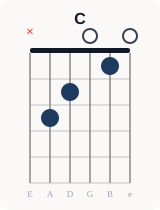
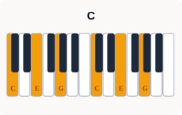
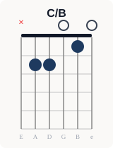
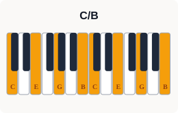
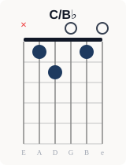
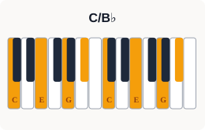
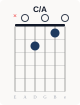
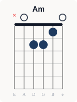
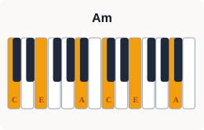

<div style="background:#eceae7;border-radius:8px;padding:1.4rem 1.6rem;margin:1.5rem 0;border-left:4px solid #1e3a5f;"><h3 style="color:#111827;margin-top:0;font-size:1rem;font-weight:700;">🎵 コード進行図（Cキー）</h3><span style="display:block;color:#374151;font-size:.9rem;margin:.4rem 0 1.2rem;"><strong>C</strong> → <strong>CB</strong> → <strong>CBb</strong> → <strong>CA</strong> → <strong>Am</strong></span><div style="display:grid;grid-template-columns:repeat(4,1fr);gap:1rem;overflow-x:auto;"><div style="text-align:center;min-width:0;"><span style="display:block;font-size:.85rem;font-weight:700;color:#111827;margin:0 0 6px;">C</span><span style="display:block;font-size:.7rem;color:#6b7280;margin:0 0 4px;">ギター</span><span style="display:block;font-size:.7rem;color:#6b7280;margin:0 0 4px;">ピアノ</span></div><div style="text-align:center;min-width:0;"><span style="display:block;font-size:.85rem;font-weight:700;color:#111827;margin:0 0 6px;">C/B</span><span style="display:block;font-size:.7rem;color:#6b7280;margin:0 0 4px;">ギター</span><span style="display:block;font-size:.7rem;color:#6b7280;margin:0 0 4px;">ピアノ</span></div><div style="text-align:center;min-width:0;"><span style="display:block;font-size:.85rem;font-weight:700;color:#111827;margin:0 0 6px;">C/Bb</span><span style="display:block;font-size:.7rem;color:#6b7280;margin:0 0 4px;">ギター</span><span style="display:block;font-size:.7rem;color:#6b7280;margin:0 0 4px;">ピアノ</span></div><div style="text-align:center;min-width:0;"><span style="display:block;font-size:.85rem;font-weight:700;color:#111827;margin:0 0 6px;">C/A</span><span style="display:block;font-size:.7rem;color:#6b7280;margin:0 0 4px;">ギター</span><span style="display:block;font-size:.7rem;color:#6b7280;margin:0 0 4px;">ピアノ</span></div><div style="text-align:center;min-width:0;"><span style="display:block;font-size:.85rem;font-weight:700;color:#111827;margin:0 0 6px;">Am</span><span style="display:block;font-size:.7rem;color:#6b7280;margin:0 0 4px;">ギター</span><span style="display:block;font-size:.7rem;color:#6b7280;margin:0 0 4px;">ピアノ</span></div></div><span style="display:block;color:#6b7280;font-size:.75rem;margin:.8rem 0 0;">※ Cキー表示。実際の楽曲は移調される場合があります。</span><span style="display:block;font-size:.85rem;font-weight:700;color:#374151;margin:1.2rem 0 .5rem;">🎵 演奏する楽器を探してみよう</span><div style="display:flex;flex-wrap:wrap;gap:.5rem;align-items:center;"><span style="font-size:.8rem;font-weight:700;color:#374151;white-space:nowrap;">🎸 ギター</span><a href="https://h.accesstrade.net/sp/cc?rk=01001xqc00os63&url=https%3A%2F%2Fwww.soundhouse.co.jp%2Fsearch%2Findex%2F%3Fsearch_all%3D%25E3%2582%25A2%25E3%2582%25B3%25E3%2583%25BC%25E3%2582%25B9%25E3%2583%2586%25E3%2582%25A3%25E3%2583%2583%25E3%2582%25AF%25E3%2582%25AE%25E3%2582%25BF%25E3%2583%25BC" target="_blank" rel="nofollow noopener" style="display:inline-block;text-decoration:none;" title="フォークギターをサウンドハウスで探す"></a><a href="https://hb.afl.rakuten.co.jp/hgc/58997230.53a20055.58997231.9fa569e6/?pc=https%3A%2F%2Fsearch.rakuten.co.jp%2Fsearch%2Fmall%2F%25E3%2583%2595%25E3%2582%25A9%25E3%2583%25BC%25E3%2582%25AF%25E3%2582%25AE%25E3%2582%25BF%25E3%2583%25BC%2B%25E5%2588%259D%25E5%25BF%2583%25E8%2580%2585%2F&m=https%3A%2F%2Fsearch.rakuten.co.jp%2Fsearch%2Fmall%2F%25E3%2583%2595%25E3%2582%25A9%25E3%2583%25BC%25E3%2582%25AF%25E3%2582%25AE%25E3%2582%25BF%25E3%2583%25BC%2B%25E5%2588%259D%25E5%25BF%2583%25E8%2580%2585%2F" target="_blank" rel="nofollow noopener" style="display:inline-block;text-decoration:none;" title="フォークギターを楽天市場で探す"></a><span style="display:inline-block;width:1px;height:24px;background:#d1d5db;margin:0 .4rem;vertical-align:middle;"></span><span style="font-size:.8rem;font-weight:700;color:#374151;white-space:nowrap;">🎹 キーボード</span><a href="https://h.accesstrade.net/sp/cc?rk=01001xqc00os63&url=https%3A%2F%2Fwww.soundhouse.co.jp%2Fsearch%2Findex%2F%3Fsearch_all%3D%25E3%2582%25AD%25E3%2583%25BC%25E3%2583%259C%25E3%2583%25BC%25E3%2583%2589" target="_blank" rel="nofollow noopener" style="display:inline-block;text-decoration:none;" title="ポータブルキーボードをサウンドハウスで探す"></a><a href="https://hb.afl.rakuten.co.jp/hgc/58997230.53a20055.58997231.9fa569e6/?pc=https%3A%2F%2Fsearch.rakuten.co.jp%2Fsearch%2Fmall%2F%25E3%2583%259D%25E3%2583%25BC%25E3%2582%25BF%25E3%2583%2596%25E3%2583%25AB%25E3%2582%25AD%25E3%2583%25BC%25E3%2583%259C%25E3%2583%25BC%25E3%2583%2589%2F&m=https%3A%2F%2Fsearch.rakuten.co.jp%2Fsearch%2Fmall%2F%25E3%2583%259D%25E3%2583%25BC%25E3%2582%25BF%25E3%2583%2596%25E3%2583%25AB%25E3%2582%25AD%25E3%2583%25BC%25E3%2583%259C%25E3%2583%25BC%25E3%2583%2589%2F" target="_blank" rel="nofollow noopener" style="display:inline-block;text-decoration:none;" title="ポータブルキーボードを楽天市場で探す"></a></div></div>


## クリシェ進行とは？半音下降が生む哀愁

コードの響きを保ったまま、ベースや和音の中の1音だけが半音ずつ動く進行を「ライン・クリシェ」と呼ぶ（英語版Wikipediaの定義では「止まっている和音に対して動く半音階の線」）。ベースが C → C/B → C/B♭ → C/A と下がる形のほか、Am → AmM7 → Am7 → Am6 のように和音の中の1音（ラ→ソ#→ソ→ファ#）が下がる形もある。ビートルズ「Michelle」のイントロや中島みゆき「糸」のサビで聴ける。

**ベースライン例（Cキー）：ド → シ → シ♭ → ラ**

<div style="background:#eceae7;border-radius:8px;padding:1.2rem 1.4rem;margin:1.5rem 0;border-left:4px solid #1e3a5f;"><h3 style="color:#111827;margin-top:0;font-size:1rem;font-weight:700;">🌍 世界での使われ方</h3><ul style="color:#111827;"><li><strong>欧米</strong>：ビートルズ「Michelle」のイントロ（Fm→FmM7→Fm7→Fm6）など。ジャズのスタンダード曲でもよく使われる手法</li><li><strong>日本</strong>：昭和の歌謡曲（ルビーの指環・時の流れに身をまかせ）から、J-POP（糸・and I love you）、2010年代のバンド（back number「花束」・Official髭男dism「115万キロのフィルム」）まで使われている</li></ul></div>

---

## クリシェ進行を使った代表曲20選

※ カッコ内の度数（Ⅰ・Ⅵmなど）は、その曲の長調のキーを基準にしています。短調の曲では主和音（Ⅰm）を、平行調の長調から見た「Ⅵm」と書いています。


<div class="song-grid" style="display:grid;grid-template-columns:repeat(2,minmax(0,1fr));gap:.6rem;margin:1rem 0;"><div style="background:#f0eeeb;border-radius:6px;padding:1rem 1.2rem;margin:0;border-left:3px solid #1e3a5f;"><div style="display:flex;align-items:baseline;gap:.6rem;margin-bottom:.5rem;">  <span style="color:#64748b;font-size:.8rem;min-width:1.8rem;">#01</span>  <span style="color:#111827;font-weight:bold;">「Michelle」</span>  <span style="color:#64748b;font-size:.85rem;">（1965年）</span>  <span style="color:#4b5563;">— The Beatles</span></div><span style="display:block;color:#6b7280;font-size:.82rem;margin:.2rem 0 .7rem 2.4rem;">収録: アルバム「Rubber Soul」。イントロで使用（Ⅰm→ⅠmM7→Ⅰm7→Ⅰm6→♭ⅥM7→Ⅴ）</span><div class="song-links"><a class="song-btn-img" href="https://ck.jp.ap.valuecommerce.com/servlet/referral?sid=3771735&pid=892732031&vc_url=https%3A%2F%2Frecochoku.jp%2Fsearch%2Fall%3Fq%3DMichelle%2520Beatles%2520Rubber%2520Soul" target="_blank" rel="nofollow sponsored noopener"></a><a class="song-btn-img" href="https://www.print-gakufu.com/search/result/score___keyword__Michelle/" target="_blank" rel="nofollow sponsored noopener"></a></div></div><div style="background:#f0eeeb;border-radius:6px;padding:1rem 1.2rem;margin:0;border-left:3px solid #1e3a5f;"><div style="display:flex;align-items:baseline;gap:.6rem;margin-bottom:.5rem;">  <span style="color:#64748b;font-size:.8rem;min-width:1.8rem;">#02</span>  <span style="color:#111827;font-weight:bold;">「オリビアを聴きながら」</span>  <span style="color:#64748b;font-size:.85rem;">（1978年）</span>  <span style="color:#4b5563;">— 杏里</span></div><span style="display:block;color:#6b7280;font-size:.82rem;margin:.2rem 0 .7rem 2.4rem;">収録: デビューシングル（作詞・作曲：尾崎亜美）。「疲れ果てたあなた」で使用（Ⅵm→ⅥmM7→Ⅵm7→♯Ⅳm7-5）</span><div class="song-links"><a class="song-btn-img" href="https://ck.jp.ap.valuecommerce.com/servlet/referral?sid=3771735&pid=892732031&vc_url=https%3A%2F%2Frecochoku.jp%2Fsearch%2Fall%3Fq%3D%25E3%2582%25AA%25E3%2583%25AA%25E3%2583%2593%25E3%2582%25A2%25E3%2582%2592%25E8%2581%25B4%25E3%2581%258D%25E3%2581%25AA%25E3%2581%258C%25E3%2582%2589%2520%25E6%259D%258F%25E9%2587%258C" target="_blank" rel="nofollow sponsored noopener"></a><a class="song-btn-img" href="https://www.print-gakufu.com/search/result/score___keyword__%E3%82%AA%E3%83%AA%E3%83%93%E3%82%A2%E3%82%92%E8%81%B4%E3%81%8D%E3%81%AA%E3%81%8C%E3%82%89/" target="_blank" rel="nofollow sponsored noopener"></a></div></div><div style="background:#f0eeeb;border-radius:6px;padding:1rem 1.2rem;margin:0;border-left:3px solid #1e3a5f;"><div style="display:flex;align-items:baseline;gap:.6rem;margin-bottom:.5rem;">  <span style="color:#64748b;font-size:.8rem;min-width:1.8rem;">#03</span>  <span style="color:#111827;font-weight:bold;">「真夜中のドア〜stay with me」</span>  <span style="color:#64748b;font-size:.85rem;">（1979年）</span>  <span style="color:#4b5563;">— 松原みき</span></div><span style="display:block;color:#6b7280;font-size:.82rem;margin:.2rem 0 .7rem 2.4rem;">収録: シングル。「帰らないでと泣いた」などで使用（Ⅵm→ⅥmM7→Ⅵm7→Ⅵm6）</span><div class="song-links"><a class="song-btn-img" href="https://ck.jp.ap.valuecommerce.com/servlet/referral?sid=3771735&pid=892732031&vc_url=https%3A%2F%2Frecochoku.jp%2Fsearch%2Fall%3Fq%3DStay%2520With%2520Me%2520Miki%2520Matsubara" target="_blank" rel="nofollow sponsored noopener"></a><a class="song-btn-img" href="https://www.print-gakufu.com/search/result/score___keyword__%E7%9C%9F%E5%A4%9C%E4%B8%AD%E3%81%AE%E3%83%89%E3%82%A2%E3%80%9Cstay%20with%20me/" target="_blank" rel="nofollow sponsored noopener"></a></div></div><div style="background:#f0eeeb;border-radius:6px;padding:1rem 1.2rem;margin:0;border-left:3px solid #1e3a5f;"><div style="display:flex;align-items:baseline;gap:.6rem;margin-bottom:.5rem;">  <span style="color:#64748b;font-size:.8rem;min-width:1.8rem;">#04</span>  <span style="color:#111827;font-weight:bold;">「いとしのエリー」</span>  <span style="color:#64748b;font-size:.85rem;">（1979年）</span>  <span style="color:#4b5563;">— サザンオールスターズ</span></div><span style="display:block;color:#6b7280;font-size:.82rem;margin:.2rem 0 .7rem 2.4rem;">収録: シングル。「二人がもしもさめて」などで使用（Ⅰ→ⅠM7→Ⅰ7→Ⅳ6）</span><div class="song-links"><a class="song-btn-img" href="https://ck.jp.ap.valuecommerce.com/servlet/referral?sid=3771735&pid=892732031&vc_url=https%3A%2F%2Frecochoku.jp%2Fsearch%2Fall%3Fq%3D%25E3%2581%2584%25E3%2581%25A8%25E3%2581%2597%25E3%2581%25AE%25E3%2582%25A8%25E3%2583%25AA%25E3%2583%25BC%2520%25E3%2582%25B5%25E3%2582%25B6%25E3%2583%25B3%25E3%2582%25AA%25E3%2583%25BC%25E3%2583%25AB%25E3%2582%25B9%25E3%2582%25BF%25E3%2583%25BC%25E3%2582%25BA" target="_blank" rel="nofollow sponsored noopener"></a><a class="song-btn-img" href="https://www.print-gakufu.com/search/result/score___keyword__%E3%81%84%E3%81%A8%E3%81%97%E3%81%AE%E3%82%A8%E3%83%AA%E3%83%BC/" target="_blank" rel="nofollow sponsored noopener"></a></div></div><div style="background:#f0eeeb;border-radius:6px;padding:1rem 1.2rem;margin:0;border-left:3px solid #1e3a5f;"><div style="display:flex;align-items:baseline;gap:.6rem;margin-bottom:.5rem;">  <span style="color:#64748b;font-size:.8rem;min-width:1.8rem;">#05</span>  <span style="color:#111827;font-weight:bold;">「さよならの向う側」</span>  <span style="color:#64748b;font-size:.85rem;">（1980年）</span>  <span style="color:#4b5563;">— 山口百恵</span></div><span style="display:block;color:#6b7280;font-size:.82rem;margin:.2rem 0 .7rem 2.4rem;">収録: シングル。「何億光年 輝く星にも」などで使用（ⅠM7→Ⅰ7→ⅣM7）</span><div class="song-links"><a class="song-btn-img" href="https://ck.jp.ap.valuecommerce.com/servlet/referral?sid=3771735&pid=892732031&vc_url=https%3A%2F%2Frecochoku.jp%2Fsearch%2Fall%3Fq%3D%25E3%2581%2595%25E3%2582%2588%25E3%2581%25AA%25E3%2582%2589%25E3%2581%25AE%25E5%2590%2591%25E3%2581%2586%25E5%2581%25B4%2520%25E5%25B1%25B1%25E5%258F%25A3%25E7%2599%25BE%25E6%2581%25B5" target="_blank" rel="nofollow sponsored noopener"></a><a class="song-btn-img" href="https://www.print-gakufu.com/search/result/score___keyword__%E3%81%95%E3%82%88%E3%81%AA%E3%82%89%E3%81%AE%E5%90%91%E3%81%86%E5%81%B4/" target="_blank" rel="nofollow sponsored noopener"></a></div></div><div style="background:#f0eeeb;border-radius:6px;padding:1rem 1.2rem;margin:0;border-left:3px solid #1e3a5f;"><div style="display:flex;align-items:baseline;gap:.6rem;margin-bottom:.5rem;">  <span style="color:#64748b;font-size:.8rem;min-width:1.8rem;">#06</span>  <span style="color:#111827;font-weight:bold;">「ルビーの指環」</span>  <span style="color:#64748b;font-size:.85rem;">（1981年）</span>  <span style="color:#4b5563;">— 寺尾聰</span></div><span style="display:block;color:#6b7280;font-size:.82rem;margin:.2rem 0 .7rem 2.4rem;">収録: シングル。イントロで使用（Ⅵm→ⅥmM7→Ⅵm7→Ⅵm6）</span><div class="song-links"><a class="song-btn-img" href="https://ck.jp.ap.valuecommerce.com/servlet/referral?sid=3771735&pid=892732031&vc_url=https%3A%2F%2Frecochoku.jp%2Fsearch%2Fall%3Fq%3D%25E3%2583%25AB%25E3%2583%2593%25E3%2583%25BC%25E3%2581%25AE%25E6%258C%2587%25E7%2592%25B0%2520%25E5%25AF%25BA%25E5%25B0%25BE%25E8%2581%25B0" target="_blank" rel="nofollow sponsored noopener"></a><a class="song-btn-img" href="https://www.print-gakufu.com/search/result/score___keyword__%E3%83%AB%E3%83%93%E3%83%BC%E3%81%AE%E6%8C%87%E7%92%B0/" target="_blank" rel="nofollow sponsored noopener"></a></div></div><div style="background:#f0eeeb;border-radius:6px;padding:1rem 1.2rem;margin:0;border-left:3px solid #1e3a5f;"><div style="display:flex;align-items:baseline;gap:.6rem;margin-bottom:.5rem;">  <span style="color:#64748b;font-size:.8rem;min-width:1.8rem;">#07</span>  <span style="color:#111827;font-weight:bold;">「シルエット・ロマンス」</span>  <span style="color:#64748b;font-size:.85rem;">（1981年）</span>  <span style="color:#4b5563;">— 大橋純子</span></div><span style="display:block;color:#6b7280;font-size:.82rem;margin:.2rem 0 .7rem 2.4rem;">収録: シングル。サビ「もっと ロマンス」で使用（Ⅵm→Ⅵm/Ⅴ→Ⅵm/♯Ⅳ→Ⅵm/Ⅳ→Ⅲ7。ベースがⅥ→Ⅴ→♯Ⅳ→Ⅳと下がる）</span><div class="song-links"><a class="song-btn-img" href="https://music.youtube.com/search?q=%E3%82%B7%E3%83%AB%E3%82%A8%E3%83%83%E3%83%88%E3%83%BB%E3%83%AD%E3%83%9E%E3%83%B3%E3%82%B9%20%E5%A4%A7%E6%A9%8B%E7%B4%94%E5%AD%90" target="_blank" rel="nofollow noopener"></a><a class="song-btn-img" href="https://www.print-gakufu.com/search/result/score___keyword__%E3%82%B7%E3%83%AB%E3%82%A8%E3%83%83%E3%83%88%E3%83%BB%E3%83%AD%E3%83%9E%E3%83%B3%E3%82%B9/" target="_blank" rel="nofollow sponsored noopener"></a></div></div><div style="background:#f0eeeb;border-radius:6px;padding:1rem 1.2rem;margin:0;border-left:3px solid #1e3a5f;"><div style="display:flex;align-items:baseline;gap:.6rem;margin-bottom:.5rem;">  <span style="color:#64748b;font-size:.8rem;min-width:1.8rem;">#08</span>  <span style="color:#111827;font-weight:bold;">「瞳はダイアモンド」</span>  <span style="color:#64748b;font-size:.85rem;">（1983年）</span>  <span style="color:#4b5563;">— 松田聖子</span></div><span style="display:block;color:#6b7280;font-size:.82rem;margin:.2rem 0 .7rem 2.4rem;">収録: シングル（作曲：呉田軽穂＝松任谷由実）。サビ「愛してたって 言わないで」で使用（Ⅵm→ⅥmM7→Ⅵm7→♯Ⅳm7-5→Ⅱm7）</span><div class="song-links"><a class="song-btn-img" href="https://ck.jp.ap.valuecommerce.com/servlet/referral?sid=3771735&pid=892732031&vc_url=https%3A%2F%2Frecochoku.jp%2Fsearch%2Fall%3Fq%3D%25E7%259E%25B3%25E3%2581%25AF%25E3%2583%2580%25E3%2582%25A4%25E3%2582%25A2%25E3%2583%25A2%25E3%2583%25B3%25E3%2583%2589" target="_blank" rel="nofollow sponsored noopener"></a><a class="song-btn-img" href="https://www.print-gakufu.com/search/result/score___keyword__%E7%9E%B3%E3%81%AF%E3%83%80%E3%82%A4%E3%82%A2%E3%83%A2%E3%83%B3%E3%83%89/" target="_blank" rel="nofollow sponsored noopener"></a></div></div><div style="background:#f0eeeb;border-radius:6px;padding:1rem 1.2rem;margin:0;border-left:3px solid #1e3a5f;"><div style="display:flex;align-items:baseline;gap:.6rem;margin-bottom:.5rem;">  <span style="color:#64748b;font-size:.8rem;min-width:1.8rem;">#09</span>  <span style="color:#111827;font-weight:bold;">「恋におちて -Fall in love-」</span>  <span style="color:#64748b;font-size:.85rem;">（1985年）</span>  <span style="color:#4b5563;">— 小林明子</span></div><span style="display:block;color:#6b7280;font-size:.82rem;margin:.2rem 0 .7rem 2.4rem;">収録: シングル / ドラマ「金曜日の妻たちへIII 恋におちて」主題歌。サビ後半「ダイヤル回して手を止めた」で使用（Ⅵm→Ⅲ/♯Ⅴ→Ⅰ/Ⅴ→♯Ⅳm7-5。ベースがⅥ→♯Ⅴ→Ⅴ→♯Ⅳと半音ずつ下がる）</span><div class="song-links"><a class="song-btn-img" href="https://ck.jp.ap.valuecommerce.com/servlet/referral?sid=3771735&pid=892732031&vc_url=https%3A%2F%2Frecochoku.jp%2Fsearch%2Fall%3Fq%3D%25E6%2581%258B%25E3%2581%25AB%25E3%2581%258A%25E3%2581%25A1%25E3%2581%25A6%2520-Fall%2520in%2520love-" target="_blank" rel="nofollow sponsored noopener"></a><a class="song-btn-img" href="https://www.print-gakufu.com/search/result/score___keyword__%E6%81%8B%E3%81%AB%E3%81%8A%E3%81%A1%E3%81%A6/" target="_blank" rel="nofollow sponsored noopener"></a></div></div><div style="background:#f0eeeb;border-radius:6px;padding:1rem 1.2rem;margin:0;border-left:3px solid #1e3a5f;"><div style="display:flex;align-items:baseline;gap:.6rem;margin-bottom:.5rem;">  <span style="color:#64748b;font-size:.8rem;min-width:1.8rem;">#10</span>  <span style="color:#111827;font-weight:bold;">「時の流れに身をまかせ」</span>  <span style="color:#64748b;font-size:.85rem;">（1986年）</span>  <span style="color:#4b5563;">— テレサ・テン</span></div><span style="display:block;color:#6b7280;font-size:.82rem;margin:.2rem 0 .7rem 2.4rem;">収録: シングル。サビ「だからお願い そばに置いてね」で使用（Ⅵm→Ⅵm/♯Ⅴ→Ⅵm/Ⅴ→♯Ⅳm7-5。ベースがⅥ→♯Ⅴ→Ⅴ→♯Ⅳと半音ずつ下がる）</span><div class="song-links"><a class="song-btn-img" href="https://ck.jp.ap.valuecommerce.com/servlet/referral?sid=3771735&pid=892732031&vc_url=https%3A%2F%2Frecochoku.jp%2Fsearch%2Fall%3Fq%3D%25E6%2599%2582%25E3%2581%25AE%25E6%25B5%2581%25E3%2582%258C%25E3%2581%25AB%25E8%25BA%25AB%25E3%2582%2592%25E3%2581%25BE%25E3%2581%258B%25E3%2581%259B%2520%25E3%2583%2586%25E3%2583%25AC%25E3%2582%25B5%25E3%2583%25BB%25E3%2583%2586%25E3%2583%25B3" target="_blank" rel="nofollow sponsored noopener"></a><a class="song-btn-img" href="https://www.print-gakufu.com/search/result/score___keyword__%E6%99%82%E3%81%AE%E6%B5%81%E3%82%8C%E3%81%AB%E8%BA%AB%E3%82%92%E3%81%BE%E3%81%8B%E3%81%9B/" target="_blank" rel="nofollow sponsored noopener"></a></div></div><div style="background:#f0eeeb;border-radius:6px;padding:1rem 1.2rem;margin:0;border-left:3px solid #1e3a5f;"><div style="display:flex;align-items:baseline;gap:.6rem;margin-bottom:.5rem;">  <span style="color:#64748b;font-size:.8rem;min-width:1.8rem;">#11</span>  <span style="color:#111827;font-weight:bold;">「未来予想図Ⅱ」</span>  <span style="color:#64748b;font-size:.85rem;">（1989年）</span>  <span style="color:#4b5563;">— DREAMS COME TRUE</span></div><span style="display:block;color:#6b7280;font-size:.82rem;margin:.2rem 0 .7rem 2.4rem;">収録: アルバム「LOVE GOES ON…」。「あなたとだから」で使用（Ⅵm→ⅥmM7→Ⅵm7→♯Ⅳm7-5）</span><div class="song-links"><a class="song-btn-img" href="https://ck.jp.ap.valuecommerce.com/servlet/referral?sid=3771735&pid=892732031&vc_url=https%3A%2F%2Frecochoku.jp%2Fsearch%2Fall%3Fq%3D%25E6%259C%25AA%25E6%259D%25A5%25E4%25BA%2588%25E6%2583%25B3%25E5%259B%25B3%25E2%2585%25A1%2520DREAMS%2520COME%2520TRUE" target="_blank" rel="nofollow sponsored noopener"></a><a class="song-btn-img" href="https://www.print-gakufu.com/search/result/score___keyword__%E6%9C%AA%E6%9D%A5%E4%BA%88%E6%83%B3%E5%9B%B3%E2%85%A1/" target="_blank" rel="nofollow sponsored noopener"></a></div></div><div style="background:#f0eeeb;border-radius:6px;padding:1rem 1.2rem;margin:0;border-left:3px solid #1e3a5f;"><div style="display:flex;align-items:baseline;gap:.6rem;margin-bottom:.5rem;">  <span style="color:#64748b;font-size:.8rem;min-width:1.8rem;">#12</span>  <span style="color:#111827;font-weight:bold;">「糸」</span>  <span style="color:#64748b;font-size:.85rem;">（1992年）</span>  <span style="color:#4b5563;">— 中島みゆき</span></div><span style="display:block;color:#6b7280;font-size:.82rem;margin:.2rem 0 .7rem 2.4rem;">収録: アルバム「EAST ASIA」。サビ「織りなす布は」で使用（Ⅵm→ⅥmM7→Ⅵm7→♯Ⅳm7-5）</span><div class="song-links"><a class="song-btn-img" href="https://ck.jp.ap.valuecommerce.com/servlet/referral?sid=3771735&pid=892732031&vc_url=https%3A%2F%2Frecochoku.jp%2Fsearch%2Fall%3Fq%3D%25E7%25B3%25B8%2520EAST%2520ASIA" target="_blank" rel="nofollow sponsored noopener"></a><a class="song-btn-img" href="https://www.print-gakufu.com/search/result/score___keyword__%E7%B3%B8/" target="_blank" rel="nofollow sponsored noopener"></a></div></div><div style="background:#f0eeeb;border-radius:6px;padding:1rem 1.2rem;margin:0;border-left:3px solid #1e3a5f;"><div style="display:flex;align-items:baseline;gap:.6rem;margin-bottom:.5rem;">  <span style="color:#64748b;font-size:.8rem;min-width:1.8rem;">#13</span>  <span style="color:#111827;font-weight:bold;">「LOVE LOVE LOVE」</span>  <span style="color:#64748b;font-size:.85rem;">（1995年）</span>  <span style="color:#4b5563;">— DREAMS COME TRUE</span></div><span style="display:block;color:#6b7280;font-size:.82rem;margin:.2rem 0 .7rem 2.4rem;">収録: シングル / ドラマ「愛していると言ってくれ」主題歌。歌い出し「ねぇ どうして」で使用（Ⅰ→Ⅲm/Ⅶ→Ⅰ/♭Ⅶ→Ⅵ7→Ⅱm。ベースがⅠ→Ⅶ→♭Ⅶ→Ⅵと半音ずつ下がる）</span><div class="song-links"><a class="song-btn-img" href="https://ck.jp.ap.valuecommerce.com/servlet/referral?sid=3771735&pid=892732031&vc_url=https%3A%2F%2Frecochoku.jp%2Fsearch%2Fall%3Fq%3DLOVE%2520LOVE%2520LOVE%2520%25E6%2584%259B%25E3%2581%2597%25E3%2581%25A6%25E3%2581%2584%25E3%2582%258B%25E3%2581%25A8%25E8%25A8%2580%25E3%2581%25A3%25E3%2581%25A6%25E3%2581%258F%25E3%2582%258C" target="_blank" rel="nofollow sponsored noopener"></a><a class="song-btn-img" href="https://www.print-gakufu.com/search/result/score___keyword__LOVE%20LOVE%20LOVE/" target="_blank" rel="nofollow sponsored noopener"></a></div></div><div style="background:#f0eeeb;border-radius:6px;padding:1rem 1.2rem;margin:0;border-left:3px solid #1e3a5f;"><div style="display:flex;align-items:baseline;gap:.6rem;margin-bottom:.5rem;">  <span style="color:#64748b;font-size:.8rem;min-width:1.8rem;">#14</span>  <span style="color:#111827;font-weight:bold;">「今宵の月のように」</span>  <span style="color:#64748b;font-size:.85rem;">（1997年）</span>  <span style="color:#4b5563;">— エレファントカシマシ</span></div><span style="display:block;color:#6b7280;font-size:.82rem;margin:.2rem 0 .7rem 2.4rem;">収録: シングル / ドラマ「月の輝く夜だから」主題歌。Aメロ「夕暮れ過ぎて」で使用（Ⅰ→ⅠM7→Ⅰ7→Ⅵ→Ⅱm。ベースがⅠ→Ⅶ→♭Ⅶ→Ⅵと半音ずつ下がる）</span><div class="song-links"><a class="song-btn-img" href="https://ck.jp.ap.valuecommerce.com/servlet/referral?sid=3771735&pid=892732031&vc_url=https%3A%2F%2Frecochoku.jp%2Fsearch%2Fall%3Fq%3D%25E4%25BB%258A%25E5%25AE%25B5%25E3%2581%25AE%25E6%259C%2588%25E3%2581%25AE%25E3%2582%2588%25E3%2581%2586%25E3%2581%25AB%2520%25E3%2582%25A8%25E3%2583%25AC%25E3%2583%2595%25E3%2582%25A1%25E3%2583%25B3%25E3%2583%2588%25E3%2582%25AB%25E3%2582%25B7%25E3%2583%259E%25E3%2582%25B7" target="_blank" rel="nofollow sponsored noopener"></a><a class="song-btn-img" href="https://www.print-gakufu.com/search/result/score___keyword__%E4%BB%8A%E5%AE%B5%E3%81%AE%E6%9C%88%E3%81%AE%E3%82%88%E3%81%86%E3%81%AB/" target="_blank" rel="nofollow sponsored noopener"></a></div></div><div style="background:#f0eeeb;border-radius:6px;padding:1rem 1.2rem;margin:0;border-left:3px solid #1e3a5f;"><div style="display:flex;align-items:baseline;gap:.6rem;margin-bottom:.5rem;">  <span style="color:#64748b;font-size:.8rem;min-width:1.8rem;">#15</span>  <span style="color:#111827;font-weight:bold;">「僕はここにいる」</span>  <span style="color:#64748b;font-size:.85rem;">（1998年）</span>  <span style="color:#4b5563;">— 山崎まさよし</span></div><span style="display:block;color:#6b7280;font-size:.82rem;margin:.2rem 0 .7rem 2.4rem;">収録: シングル / ドラマ「奇跡の人」主題歌。Aメロ「遠い空 揺れている街並」などで使用（Ⅱm→ⅡmM7→Ⅱm7→Ⅱdim→Ⅰ）</span><div class="song-links"><a class="song-btn-img" href="https://ck.jp.ap.valuecommerce.com/servlet/referral?sid=3771735&pid=892732031&vc_url=https%3A%2F%2Frecochoku.jp%2Fsearch%2Fall%3Fq%3D%25E5%2583%2595%25E3%2581%25AF%25E3%2581%2593%25E3%2581%2593%25E3%2581%25AB%25E3%2581%2584%25E3%2582%258B%2520%25E5%25B1%25B1%25E5%25B4%258E%25E3%2581%25BE%25E3%2581%2595%25E3%2582%2588%25E3%2581%2597" target="_blank" rel="nofollow sponsored noopener"></a><a class="song-btn-img" href="https://www.print-gakufu.com/search/result/score___keyword__%E5%83%95%E3%81%AF%E3%81%93%E3%81%93%E3%81%AB%E3%81%84%E3%82%8B/" target="_blank" rel="nofollow sponsored noopener"></a></div></div><div style="background:#f0eeeb;border-radius:6px;padding:1rem 1.2rem;margin:0;border-left:3px solid #1e3a5f;"><div style="display:flex;align-items:baseline;gap:.6rem;margin-bottom:.5rem;">  <span style="color:#64748b;font-size:.8rem;min-width:1.8rem;">#16</span>  <span style="color:#111827;font-weight:bold;">「思いがかさなるその前に…」</span>  <span style="color:#64748b;font-size:.85rem;">（2004年）</span>  <span style="color:#4b5563;">— 平井堅</span></div><span style="display:block;color:#6b7280;font-size:.82rem;margin:.2rem 0 .7rem 2.4rem;">収録: シングル。サビ「ねぇ いつかキミは」で使用（Ⅰ→Ⅴ/Ⅶ→Ⅴm/♭Ⅶ→Ⅵ7→Ⅱm。ベースがⅠ→Ⅶ→♭Ⅶ→Ⅵと半音ずつ下がる）</span><div class="song-links"><a class="song-btn-img" href="https://ck.jp.ap.valuecommerce.com/servlet/referral?sid=3771735&pid=892732031&vc_url=https%3A%2F%2Frecochoku.jp%2Fsearch%2Fall%3Fq%3D%25E6%2580%259D%25E3%2581%2584%25E3%2581%258C%25E3%2581%258B%25E3%2581%2595%25E3%2581%25AA%25E3%2582%258B%2520%25E5%25B9%25B3%25E4%25BA%2595%25E5%25A0%2585" target="_blank" rel="nofollow sponsored noopener"></a><a class="song-btn-img" href="https://www.print-gakufu.com/search/result/score___keyword__%E6%80%9D%E3%81%84%E3%81%8C%E3%81%8B%E3%81%95%E3%81%AA%E3%82%8B%E3%81%9D%E3%81%AE%E5%89%8D%E3%81%AB/" target="_blank" rel="nofollow sponsored noopener"></a></div></div><div style="background:#f0eeeb;border-radius:6px;padding:1rem 1.2rem;margin:0;border-left:3px solid #1e3a5f;"><div style="display:flex;align-items:baseline;gap:.6rem;margin-bottom:.5rem;">  <span style="color:#64748b;font-size:.8rem;min-width:1.8rem;">#17</span>  <span style="color:#111827;font-weight:bold;">「and I love you」</span>  <span style="color:#64748b;font-size:.85rem;">（2005年）</span>  <span style="color:#4b5563;">— Mr.Children</span></div><span style="display:block;color:#6b7280;font-size:.82rem;margin:.2rem 0 .7rem 2.4rem;">収録: アルバム「I ♥ U」。Aメロ「飛べるよ 君にも」などで使用（Ⅰ→Ⅰaug→Ⅰ6→Ⅰ7）</span><div class="song-links"><a class="song-btn-img" href="https://ck.jp.ap.valuecommerce.com/servlet/referral?sid=3771735&pid=892732031&vc_url=https%3A%2F%2Frecochoku.jp%2Fsearch%2Fall%3Fq%3DMr.Children%2520and%2520I%2520love%2520you" target="_blank" rel="nofollow sponsored noopener"></a><a class="song-btn-img" href="https://www.print-gakufu.com/search/result/score___keyword__and%20I%20love%20you/" target="_blank" rel="nofollow sponsored noopener"></a></div></div><div style="background:#f0eeeb;border-radius:6px;padding:1rem 1.2rem;margin:0;border-left:3px solid #1e3a5f;"><div style="display:flex;align-items:baseline;gap:.6rem;margin-bottom:.5rem;">  <span style="color:#64748b;font-size:.8rem;min-width:1.8rem;">#18</span>  <span style="color:#111827;font-weight:bold;">「ガーネット」</span>  <span style="color:#64748b;font-size:.85rem;">（2006年）</span>  <span style="color:#4b5563;">— 奥華子</span></div><span style="display:block;color:#6b7280;font-size:.82rem;margin:.2rem 0 .7rem 2.4rem;">収録: シングル / 映画「時をかける少女」主題歌。「思い出さなくても 大丈夫」で使用（Ⅵm→ⅥmM7→Ⅵm7→♯Ⅳdim。ベースがⅥ→♯Ⅴ→Ⅴ→♯Ⅳと半音ずつ下がる）</span><div class="song-links"><a class="song-btn-img" href="https://ck.jp.ap.valuecommerce.com/servlet/referral?sid=3771735&pid=892732031&vc_url=https%3A%2F%2Frecochoku.jp%2Fsearch%2Fall%3Fq%3D%25E3%2582%25AC%25E3%2583%25BC%25E3%2583%258D%25E3%2583%2583%25E3%2583%2588%2520%25E5%25A5%25A5" target="_blank" rel="nofollow sponsored noopener"></a><a class="song-btn-img" href="https://www.print-gakufu.com/search/result/score___keyword__%E3%82%AC%E3%83%BC%E3%83%8D%E3%83%83%E3%83%88/" target="_blank" rel="nofollow sponsored noopener"></a></div></div><div style="background:#f0eeeb;border-radius:6px;padding:1rem 1.2rem;margin:0;border-left:3px solid #1e3a5f;"><div style="display:flex;align-items:baseline;gap:.6rem;margin-bottom:.5rem;">  <span style="color:#64748b;font-size:.8rem;min-width:1.8rem;">#19</span>  <span style="color:#111827;font-weight:bold;">「花束」</span>  <span style="color:#64748b;font-size:.85rem;">（2011年）</span>  <span style="color:#4b5563;">— back number</span></div><span style="display:block;color:#6b7280;font-size:.82rem;margin:.2rem 0 .7rem 2.4rem;">収録: シングル。イントロで使用（Ⅰ→ⅠM7→Ⅰ7→Ⅵ7）</span><div class="song-links"><a class="song-btn-img" href="https://ck.jp.ap.valuecommerce.com/servlet/referral?sid=3771735&pid=892732031&vc_url=https%3A%2F%2Frecochoku.jp%2Fsearch%2Fall%3Fq%3D%25E8%258A%25B1%25E6%259D%259F%2520back%2520number" target="_blank" rel="nofollow sponsored noopener"></a><a class="song-btn-img" href="https://www.print-gakufu.com/search/result/score___keyword__%E8%8A%B1%E6%9D%9F/" target="_blank" rel="nofollow sponsored noopener"></a></div></div><div style="background:#f0eeeb;border-radius:6px;padding:1rem 1.2rem;margin:0;border-left:3px solid #1e3a5f;"><div style="display:flex;align-items:baseline;gap:.6rem;margin-bottom:.5rem;">  <span style="color:#64748b;font-size:.8rem;min-width:1.8rem;">#20</span>  <span style="color:#111827;font-weight:bold;">「115万キロのフィルム」</span>  <span style="color:#64748b;font-size:.85rem;">（2018年）</span>  <span style="color:#4b5563;">— Official髭男dism</span></div><span style="display:block;color:#6b7280;font-size:.82rem;margin:.2rem 0 .7rem 2.4rem;">収録: アルバム「エスカパレード」。サビ「見どころなんだからさ」で使用（Ⅵm→ⅥmM7→Ⅵm7→Ⅵ。ベースがⅥ→♯Ⅴ→Ⅴと半音ずつ下がる）</span><div class="song-links"><a class="song-btn-img" href="https://ck.jp.ap.valuecommerce.com/servlet/referral?sid=3771735&pid=892732031&vc_url=https%3A%2F%2Frecochoku.jp%2Fsearch%2Fall%3Fq%3D%25E3%2582%25A8%25E3%2582%25B9%25E3%2582%25AB%25E3%2583%2591%25E3%2583%25AC%25E3%2583%25BC%25E3%2583%2589" target="_blank" rel="nofollow sponsored noopener"></a><a class="song-btn-img" href="https://www.print-gakufu.com/search/result/score___keyword__115%E4%B8%87%E3%82%AD%E3%83%AD%E3%81%AE%E3%83%95%E3%82%A3%E3%83%AB%E3%83%A0/" target="_blank" rel="nofollow sponsored noopener"></a></div></div></div>

---

## アニメ・ドラマの主題歌でのクリシェ

代表曲のうち、ガーネットはアニメ映画「時をかける少女」の主題歌。僕はここにいる（奇跡の人）・今宵の月のように（月の輝く夜だから）・LOVE LOVE LOVE（愛していると言ってくれ）・恋におちて（金曜日の妻たちへIII）とドラマの主題歌にも多い。

<div style="background:#eceae7;border-radius:8px;padding:1.2rem 1.4rem;margin:1.5rem 0;border-left:4px solid #1e3a5f;"><h3 style="color:#111827;margin-top:0;font-size:1rem;font-weight:700;">🎌 クリシェと主題歌の相性</h3><p style="color:#111827;margin:0;">和音を変えずに1音だけを少しずつ動かすので、メロディーを邪魔せずに伴奏の表情だけを変えられる。歌を引き立てたい主題歌やバラードと相性がよい。</p></div>

---

## ギター・ベースでの弾き方

```
コード: C    C/B   C/B♭  Am
ベース: ド →  シ →  シ♭ → ラ（半音下降）
```

ベースラインを意識した伴奏が核心。左手（ピアノ）やベースギターで表現する。

<div style="display:flex;flex-wrap:wrap;gap:.6rem;align-items:center;margin-top:.8rem;"><span style="font-size:.78rem;font-weight:700;color:#374151;white-space:nowrap;">🎸 ギターを探す</span><a href="https://h.accesstrade.net/sp/cc?rk=01001xqc00os63&url=https%3A%2F%2Fwww.soundhouse.co.jp%2Fsearch%2Findex%2F%3Fsearch_all%3D%25E3%2582%25A2%25E3%2582%25B3%25E3%2583%25BC%25E3%2582%25B9%25E3%2583%2586%25E3%2582%25A3%25E3%2583%2583%25E3%2582%25AF%25E3%2582%25AE%25E3%2582%25BF%25E3%2583%25BC" target="_blank" rel="nofollow noopener" title="ギターをサウンドハウスで探す"></a><a href="https://hb.afl.rakuten.co.jp/hgc/58997230.53a20055.58997231.9fa569e6/?pc=https%3A%2F%2Fsearch.rakuten.co.jp%2Fsearch%2Fmall%2F%25E3%2582%25A2%25E3%2582%25B3%25E3%2583%25BC%25E3%2582%25B9%25E3%2583%2586%25E3%2582%25A3%25E3%2583%2583%25E3%2582%25AF%25E3%2582%25AE%25E3%2582%25BF%25E3%2583%25BC%2B%25E5%2588%259D%25E5%25BF%2583%25E8%2580%2585%2B%25E3%2582%25BB%25E3%2583%2583%25E3%2583%2588%2F&m=https%3A%2F%2Fsearch.rakuten.co.jp%2Fsearch%2Fmall%2F%25E3%2582%25A2%25E3%2582%25B3%25E3%2583%25BC%25E3%2582%25B9%25E3%2583%2586%25E3%2582%25A3%25E3%2583%2583%25E3%2582%25AF%25E3%2582%25AE%25E3%2582%25BF%25E3%2583%25BC%2B%25E5%2588%259D%25E5%25BF%2583%25E8%2580%2585%2B%25E3%2582%25BB%25E3%2583%2583%25E3%2583%2588%2F" target="_blank" rel="nofollow noopener" title="アコースティックギターを楽天市場で探す"></a><span style="display:inline-block;width:1px;height:24px;background:#d1d5db;margin:0 .2rem;"></span><span style="font-size:.78rem;font-weight:700;color:#374151;white-space:nowrap;">📖 コード教則本</span><a href="https://hb.afl.rakuten.co.jp/hgc/58997230.53a20055.58997231.9fa569e6/?pc=https%3A%2F%2Fbooks.rakuten.co.jp%2Fsearch%3Fsitem%3D%25E3%2582%25AE%25E3%2582%25BF%25E3%2583%25BC%2B%25E3%2582%25B3%25E3%2583%25BC%25E3%2583%2589%2B%25E6%2595%2599%25E5%2589%2587%25E6%259C%25AC%26g%3D212&m=https%3A%2F%2Fbooks.rakuten.co.jp%2Fsearch%3Fsitem%3D%25E3%2582%25AE%25E3%2582%25BF%25E3%2583%25BC%2B%25E3%2582%25B3%25E3%2583%25BC%25E3%2583%2589%2B%25E6%2595%2599%25E5%2589%2587%25E6%259C%25AC%26g%3D212" target="_blank" rel="nofollow noopener" title="ギターコード教則本を楽天ブックスで探す"></a></div>

---

## ピアノ・キーボードでの弾き方

左手で半音下降ベースを弾きながら、右手でコードを保持する（マイナーの形 Am → AmM7 → Am7 → Am6 は、和音の中のラ→ソ#→ソ→ファ#が動く）：

```
C    : ド・ミ・ソ  （ベース: ド）
C/B  : ド・ミ・ソ  （ベース: シ）
C/B♭ : ド・ミ・ソ  （ベース: シ♭）
Am   : ラ・ド・ミ  （ベース: ラ）
```

<div style="display:flex;flex-wrap:wrap;gap:.6rem;align-items:center;margin-top:.8rem;"><span style="font-size:.78rem;font-weight:700;color:#374151;white-space:nowrap;">🎹 キーボードを探す</span><a href="https://h.accesstrade.net/sp/cc?rk=01001xqc00os63&url=https%3A%2F%2Fwww.soundhouse.co.jp%2Fsearch%2Findex%2F%3Fsearch_all%3D%25E3%2582%25AD%25E3%2583%25BC%25E3%2583%259C%25E3%2583%25BC%25E3%2583%2589" target="_blank" rel="nofollow noopener" title="キーボードをサウンドハウスで探す"></a><a href="https://hb.afl.rakuten.co.jp/hgc/58997230.53a20055.58997231.9fa569e6/?pc=https%3A%2F%2Fsearch.rakuten.co.jp%2Fsearch%2Fmall%2F%25E3%2583%259D%25E3%2583%25BC%25E3%2582%25BF%25E3%2583%2596%25E3%2583%25AB%25E3%2582%25AD%25E3%2583%25BC%25E3%2583%259C%25E3%2583%25BC%25E3%2583%2589%2F&m=https%3A%2F%2Fsearch.rakuten.co.jp%2Fsearch%2Fmall%2F%25E3%2583%259D%25E3%2583%25BC%25E3%2582%25BF%25E3%2583%2596%25E3%2583%25AB%25E3%2582%25AD%25E3%2583%25BC%25E3%2583%259C%25E3%2583%25BC%25E3%2583%2589%2F" target="_blank" rel="nofollow noopener" title="キーボードを楽天市場で探す"></a><span style="display:inline-block;width:1px;height:24px;background:#d1d5db;margin:0 .2rem;"></span><span style="font-size:.78rem;font-weight:700;color:#374151;white-space:nowrap;">📖 コード教則本</span><a href="https://hb.afl.rakuten.co.jp/hgc/58997230.53a20055.58997231.9fa569e6/?pc=https%3A%2F%2Fbooks.rakuten.co.jp%2Fsearch%3Fsitem%3D%25E3%2583%2594%25E3%2582%25A2%25E3%2583%258E%2B%25E3%2582%25B3%25E3%2583%25BC%25E3%2583%2589%2B%25E6%2595%2599%25E5%2589%2587%25E6%259C%25AC%26g%3D212&m=https%3A%2F%2Fbooks.rakuten.co.jp%2Fsearch%3Fsitem%3D%25E3%2583%2594%25E3%2582%25A2%25E3%2583%258E%2B%25E3%2582%25B3%25E3%2583%25BC%25E3%2583%2589%2B%25E6%2595%2599%25E5%2589%2587%25E6%259C%25AC%26g%3D212" target="_blank" rel="nofollow noopener" title="ピアノコード教則本を楽天ブックスで探す"></a></div>

---

## 教則本・コードブック

<div style="background:#fff7ed;border:1px solid #fed7aa;border-radius:10px;padding:1rem 1.2rem;">
<p style="font-size:.8rem;font-weight:700;color:#c2410c;margin:0 0 .6rem;">📖 コード進行の教則本を楽天ブックスで購入</p>
<a href="https://hb.afl.rakuten.co.jp/hgc/58997230.53a20055.58997231.9fa569e6/?pc=https%3A%2F%2Fbooks.rakuten.co.jp%2Fsearch%3Fsitem%3D%25E3%2582%25B3%25E3%2583%25BC%25E3%2583%2589%25E9%2580%25B2%25E8%25A1%258C%2B%25E6%2595%2599%25E5%2589%2587%25E6%259C%25AC%26g%3D212&m=https%3A%2F%2Fbooks.rakuten.co.jp%2Fsearch%3Fsitem%3D%25E3%2582%25B3%25E3%2583%25BC%25E3%2583%2589%25E9%2580%25B2%25E8%25A1%258C%2B%25E6%2595%2599%25E5%2589%2587%25E6%259C%25AC%26g%3D212" target="_blank" rel="nofollow noopener" style="display:block;text-decoration:none;text-align:center;"></a>
</div>

---

<div style="display:flex;justify-content:space-between;flex-wrap:wrap;gap:.8rem;margin:2rem 0;"><a href="/chord/chord-progression-07-blues/" style="display:inline-block;padding:.5rem 1rem;background:rgba(30,58,95,.15);border:1px solid rgba(30,58,95,.25);border-radius:8px;color:#1e3a5f;text-decoration:none;font-size:.9rem;">← #07 ブルース進行</a><span></span>

